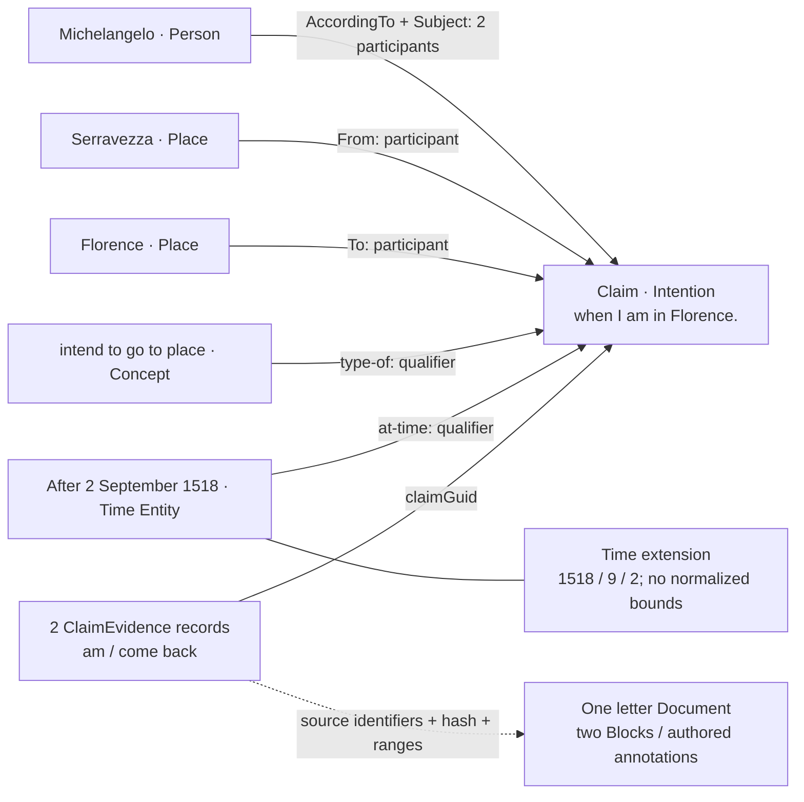

# Claims nexus: SQLite investigation

Inspected **2 November 2026**, read-only: `vaults/imported/.mutable/mutable.db`, schema version **10**, actual `sqlite_schema`, foreign-key metadata, migrations and application validation. The database contains **1,972 Claims, 4,077 participants, 3,632 qualifiers and 1,320 evidence records**. Only this report was written.

**The nexus is a central Claim record with independently identified, role-bearing participant and qualifier records linking it to Entities. A Claim is not an Entity row.** Evidence is another child-record family, carrying references to saved Document passages.

## 1. Actual SQLite structure

The following are faithful abbreviations, not a migration script. All tables shown are `STRICT`. Each of the five core tables has these common columns, omitted from their individual definitions below:

```sql
id INTEGER PRIMARY KEY,
guid TEXT NOT NULL UNIQUE,
attributes TEXT CHECK(attributes IS NULL OR json_valid(attributes)),
revision INTEGER NOT NULL DEFAULT 0 CHECK(revision >= 0),
createdByActorGuid TEXT, createdUtc TEXT,
lastUpdatedByActorGuid TEXT, modifiedUtc TEXT
```

The Actor columns are not foreign keys.

```sql
CREATE TABLE Claim (
  /* common columns */
  expression TEXT, typename TEXT
) STRICT;

CREATE TABLE ClaimParticipant (
  /* common columns */
  claimGuid TEXT NOT NULL REFERENCES Claim(guid) ON DELETE CASCADE,
  entityGuid TEXT NOT NULL REFERENCES Entity(guid) ON DELETE NO ACTION,
  role TEXT,
  ordinal INTEGER NOT NULL CHECK(ordinal >= 0),
  UNIQUE(claimGuid, ordinal)
) STRICT;

CREATE TABLE ClaimQualifier (
  /* common columns */
  claimGuid TEXT NOT NULL REFERENCES Claim(guid) ON DELETE CASCADE,
  entityGuid TEXT NOT NULL REFERENCES Entity(guid) ON DELETE NO ACTION,
  role TEXT NOT NULL CHECK(length(trim(role)) > 0),
  ordinal INTEGER NOT NULL CHECK(ordinal >= 0),
  UNIQUE(claimGuid, ordinal)
) STRICT;

CREATE TABLE ClaimEvidence (
  /* common columns */
  claimGuid TEXT NOT NULL REFERENCES Claim(guid) ON DELETE CASCADE,
  resourceGuid TEXT NOT NULL, blockGuid TEXT NOT NULL,
  authoredPropertyId TEXT, sourceContentHash TEXT NOT NULL,
  startIndex INTEGER NOT NULL CHECK(startIndex >= 0),
  endIndex INTEGER NOT NULL CHECK(endIndex >= startIndex),
  coordinate TEXT NOT NULL CHECK(coordinate IN ('cell','utf16')),
  evidenceKind TEXT NOT NULL, excerpt TEXT
) STRICT;

CREATE TABLE Entity (
  /* common columns */
  typename TEXT,
  name TEXT NOT NULL CHECK(length(trim(name)) > 0),
  nameKey TEXT NOT NULL, description TEXT,
  recoveryState TEXT NOT NULL DEFAULT 'authored'
    CHECK(recoveryState IN ('authored','recovered')),
  /* nullable JSON-checked TEXT: nameStrata, descriptionDocument, imageRef */
  deletedUtc TEXT
) STRICT;
```

`Claim` stores the expression and kind. Participants identify actors, objects, destinations, attributed sources, etc. Qualifiers classify or contextualise the Claim. Both point to ordinary Entities; a Concept is an Entity whose `typename` is `Concept`, not a separate Concept table. Evidence records an attachment to a particular source generation. **Its resource, Block and annotation identifiers have no SQL foreign keys.**

Relevant explicit indexes follow; `PRIMARY KEY`/`UNIQUE` constraints above additionally provide identity/order lookup support.

| Table | Named indexes and indexed columns |
|---|---|
| Claim | `IX_Claim_Kind(typename,guid)` |
| ClaimParticipant | `IX_ClaimParticipant_Order(claimGuid,ordinal)`; `IX_ClaimParticipant_Entity(entityGuid,role,claimGuid)`; `IX_ClaimParticipant_Role(role,entityGuid,claimGuid)` |
| ClaimQualifier | `IX_ClaimQualifier_Order(claimGuid,role,ordinal)`; `IX_ClaimQualifier_Entity(entityGuid,role,claimGuid)` |
| ClaimEvidence | `IX_ClaimEvidence_Claim(claimGuid,guid)`; `IX_ClaimEvidence_Source(resourceGuid,blockGuid,authoredPropertyId)`; `IX_ClaimEvidence_Generation(resourceGuid,sourceContentHash)` |
| Entity | `IX_Entity_Type(typename)`; `IX_Entity_Name(nameKey,guid)`; `IX_Entity_Type_Name(typename,nameKey,guid)` |

### Supporting and adjacent records

These abbreviated definitions show the relevant columns and connections; unrelated fields are omitted.

```sql
CREATE TABLE Time (
  id INTEGER PRIMARY KEY,
  entityGuid TEXT NOT NULL UNIQUE REFERENCES Entity(guid) ON DELETE CASCADE,
  expression TEXT,
  startYear INTEGER, startMonth INTEGER, startDay INTEGER,
  /* remaining start/end date/time components: nullable INTEGER;
     precision, approximation, certainty, extentKind, qualifier: nullable TEXT;
     attributes, revision and provenance columns */
  normalizationProfile TEXT, lowerBoundDay INTEGER, upperBoundDayExclusive INTEGER,
  CHECK((lowerBoundDay IS NULL AND upperBoundDayExclusive IS NULL) OR
    (lowerBoundDay IS NOT NULL AND upperBoundDayExclusive IS NOT NULL AND
     normalizationProfile IS NOT NULL AND lowerBoundDay < upperBoundDayExclusive))
) STRICT;

CREATE TABLE Resource (
  id INTEGER PRIMARY KEY, guid TEXT NOT NULL UNIQUE, path TEXT NOT NULL UNIQUE,
  typename TEXT NOT NULL, format TEXT NOT NULL, rootBlockGuid TEXT NOT NULL,
  title TEXT, contentHash TEXT NOT NULL,
  indexStatus TEXT NOT NULL CHECK(indexStatus IN
    ('complete','incomplete','stale','missing','ambiguous','unavailable'))
  /* additional file/index metadata */
) STRICT;

CREATE TABLE Block (
  id INTEGER PRIMARY KEY, guid TEXT NOT NULL UNIQUE,
  resourceGuid TEXT REFERENCES Resource(guid) ON DELETE CASCADE,
  entityGuid TEXT REFERENCES Entity(guid) ON DELETE RESTRICT,
  typename TEXT NOT NULL, authoredType TEXT NOT NULL, text TEXT,
  coordinate TEXT CHECK(coordinate IS NULL OR coordinate IN ('cell','utf16')),
  cellCount INTEGER CHECK(cellCount IS NULL OR cellCount >= 0),
  CHECK(resourceGuid IS NOT NULL OR (typename='mutable/proposition-block'
    AND authoredType='mutable/proposition-block'
    AND entityGuid IS NOT NULL AND text IS NOT NULL)),
  UNIQUE(resourceGuid,guid)
  /* additional retention, attributes and provenance columns */
) STRICT;

CREATE TABLE SourceClaimReview (
  id INTEGER PRIMARY KEY, guid TEXT NOT NULL UNIQUE,
  snapshotGuid TEXT NOT NULL REFERENCES SourceSnapshot(guid), statementId TEXT NOT NULL,
  decision TEXT NOT NULL CHECK(decision IN ('accepted','rejected')),
  claimGuid TEXT REFERENCES Claim(guid),
  attributes TEXT NOT NULL CHECK(json_valid(attributes)),
  UNIQUE(snapshotGuid,statementId)
) STRICT;
```

`Time` extends an Entity using the same identity; it has no separate `guid`. Its indexes are `IX_Time_Bounds(normalizationProfile,lowerBoundDay,upperBoundDayExclusive)` and `IX_Time_Components(startYear,startMonth,startDay,entityGuid)`.

`Resource` and ordinary `Block` rows index saved native Documents; they are not the authoring authority. Their GUID/compound unique keys support source lookup. `SourceClaimReview` is the **only additional table with a direct Claim FK** beyond the three child families. It has `IX_SourceClaimReview_Claim(claimGuid)`, default `NO ACTION` deletion semantics, and **zero records** here. Its separate external-source provenance chain is `SourceSnapshot.identityGuid → ExternalIdentity.guid → Entity` through `ExternalIdentity.entityGuid`; it is not used by the example below.

The derived `StandoffProperty` index can describe the referenced authored annotation: relevant columns are `guid TEXT NOT NULL UNIQUE`, `resourceGuid TEXT`, `sourceBlockGuid TEXT NOT NULL`, `authoredId TEXT`, `typename TEXT`, `startIndex/endIndex INTEGER NOT NULL` and `coordinate TEXT NOT NULL`. It has a cascading FK from `sourceBlockGuid` to `Block.guid` and a cascading compound FK `(resourceGuid,sourceBlockGuid) → Block(resourceGuid,guid)`. Range checks require `startIndex >= 0`, `endIndex >= startIndex`, and coordinate `cell`/`utf16`; `IX_Standoff_Block_Range(sourceBlockGuid,startIndex,endIndex)` supports passage lookup. **ClaimEvidence does not FK to this index.**

For comparison, generic `Relationship` has the common identity/revision/provenance columns, plus `sourceEntityGuid TEXT NOT NULL REFERENCES Entity(guid) ON DELETE CASCADE`, `typename TEXT NOT NULL`, and `targetEntityGuid TEXT NOT NULL REFERENCES Entity(guid) ON DELETE CASCADE`. Its endpoints are Entities, not Claims; it does not implement the participant/qualifier links.

Schema sources: [foundation](src/knowledge-sqlite/migrations/mutable/0001-foundation.sql), [semantic knowledge](src/knowledge-sqlite/migrations/mutable/0002-semantic-knowledge.sql), [source reviews](src/knowledge-sqlite/migrations/mutable/0007-deterministic-academic.sql), [Block/index revision](src/knowledge-sqlite/migrations/mutable/0008-propositions.sql), [Cardex fields](src/knowledge-sqlite/migrations/mutable/0009-cardex.sql), [Entity soft deletion](src/knowledge-sqlite/migrations/mutable/0010-cardex-soft-delete.sql).

## 2. One real imported Claim

**Claim `c3f6be8c-b260-409e-8848-fad17c5e28ef`** — `typename: "Intention"`, `expression: "when I am in Florence."`, revision **2**. Provenance retains the original `graph/nodes/claims.json` record, ordinal **236**, with the same GUID, `Role: "claim-role-intention"` and `Name` equal to this expression.

Entity keys below abbreviate repeated references only; all GUIDs are actual database values.

| Key | Entity GUID | typename | Stored name |
|---|---|---|---|
| M | `add92e01-cefe-4f13-94dd-f00eb82155b0` | Person | Michelangelo Buonarroti (b. 1475/03/06 - d. 1564/02/18) |
| F | `671ee7e7-ae1b-4a5a-9591-b40203d5108f` | Place | Florence |
| S | `66c0edd4-0404-48c9-aa24-f7822ed8919f` | Place | Serravezza |
| K | `a2d6c9a4-e641-40ad-8f07-56f58eb95c29` | Concept | intend to go (to place) |
| T | `b00bf61e-ba88-4b69-9e30-c4f5e8baae5b` | Time | `After       1518/September/2 --:--:--` |

All six incidence records below have `claimGuid` equal to the Claim above.

| Table | Record GUID | ordinal | role | entityGuid key |
|---|---|---:|---|---|
| ClaimParticipant | `2cf54358-d85d-4f1b-b259-d5633f545501` | 0 | AccordingTo | M |
| ClaimParticipant | `bc96cc9d-06a9-4a97-a4a4-7f3cbf1dbee4` | 1 | To | F |
| ClaimParticipant | `89e7985b-d02e-4a3f-8cc4-a87434ed7001` | 2 | From | S |
| ClaimParticipant | `ddf50d11-1c03-407d-b069-a022dc29b0c5` | 3 | Subject | M |
| ClaimQualifier | `4d6c23e0-e1d5-4d54-87a7-7ba369c2872f` | 0 | type-of | K |
| ClaimQualifier | `2e089fb9-2de8-4b3f-819d-102916107c7c` | 1 | at-time | T |

Thus there are **four participant links to three distinct Entities**, with Michelangelo both Subject and attributed source. The Time extension has `entityGuid=T`, `startYear=1518`, `startMonth=9`, `startDay=2`, and the same expression as T's name. Its normalization profile and bounds are NULL; legacy `Around: 2` survives in `attributes.legacyImport.unknownCodes`. The word “After” is preserved text, **not a computed temporal interval**.

Both evidence records use `claimGuid` above, `coordinate="cell"`, `evidenceKind="legacy-annotation"`, and:

- `resourceGuid`: `10ae0c36-c799-4078-a884-9ccafc1872aa`
- indexed path: `documents/michelangelo-letters/1518-09-02-[a14d91d2].ink`
- `sourceContentHash`: `7d7090d44f15b681bc0df67f807c1aea90c02f0d671c5e2a3bb4798b22924fbf`

| Evidence GUID | blockGuid | authoredPropertyId | [startIndex,endIndex) | excerpt |
|---|---|---|---|---|
| `12abd7eb-0d7b-4806-aba9-8344174184e2` | `2788a7e0-f1b2-4726-a1f4-a34f40e368a3` | `d3c4738f-1638-47c1-b591-8673eb8394f3` | [324,326) | am |
| `3e08fab8-ee81-4c54-bc27-1dda30c83d81` | `2eb46742-9c34-4bde-a184-f746e5301320` | `6a846550-c84c-4025-9f63-c6d04bd019a1` | [494,503) | come back |

The indexed surrounding sentences are “We will discuss it later on when I am in Florence.” and “When I come back to Florence I intend to obtain satisfaction, come what may.” Both hashes match the currently indexed Resource generation (`indexStatus=complete`); this inspection did not independently revalidate the live Document bytes.

**Reading the combined records:** Michelangelo is represented as intending to go from Serravezza to Florence, attributed to Michelangelo, with the displayed temporal qualification after 2 September 1518. This interpretation combines roles, Concept and text; it is not all contained in the short expression, nor does it assert that the journey happened. Evidence marks two attached textual fragments, not certified proof.



Solid role arrows express incidence direction conceptually; the underlying incidence rows each hold both endpoint GUIDs. The dotted source connection is not an SQL FK.

## 3. Semantics: schema, application and imported data

1. **Participant versus qualifier.** Both are independent, ordered Claim–Entity incidences. Participants express involvement/argument roles; qualifiers supply classification/context. SQL distinguishes their tables and role nullability, but imposes no participant-versus-qualifier Entity type rule. Application validation adds the two special qualifier rules below. The example demonstrates both families and separate ordinal sequences.

2. **`Claim.typename` versus `type-of`.** `typename` is nullable text on the Claim; the API's `kind` aliases it and rejects contradictory simultaneous values. A `type-of` qualifier instead points to a reusable Concept Entity. No rule synchronises these two forms of classification. Here `Intention` coexists with Concept “intend to go (to place)”. Imported kinds are Trait **1,136**, NULL **532**, Event **293**, Intention **6**, Opinion **5**.

3. **Role constraints.** SQL allows NULL/free text for participant roles and nonblank text for qualifiers. The canonical API limits both to 256 characters; participants may still be NULL or blank. There is no general role enumeration. Exact qualifier role `type-of` requires an Entity of type `Concept`; `at-time` requires an Entity of type `Time` with a Time extension. Other nonblank qualifier roles are accepted. Imported qualifiers use only `type-of` (**1,944**) and `at-time` (**1,688**); participant examples include Subject, Object, AccordingTo, From, To and With, plus **253 NULL roles**.

4. **Multiplicity.** SQL permits zero or many participants, qualifiers and evidence records, including repeated roles/Entities and multiple `type-of` Concepts. Only `(claimGuid,ordinal)` must be unique within each incidence table. Aggregate creation accepts at most 100 participants and 100 qualifiers in one request; later child additions mean this is not a total cardinality limit. Aggregate reads return at most 100 per child family with an incompleteness marker. Observed maxima are **6 participants, 2 qualifiers, 1 type-of Concept per Claim**: multiple Concepts are permitted, not demonstrated here.

5. **Evidence and Documents.** Evidence stores resource/Block IDs, optional authored annotation ID, content hash, coordinate system and an end-exclusive range; `excerpt` is optional. SQL guarantees the Claim parent and basic range/coordinate validity, not source existence. Authoring likewise does not require a presently available Document. Source resolution verifies Document identity and generation, Block, optional annotation identity/scope, coordinates and excerpt against saved source bytes; missing, stale or inconsistent sources remain distinguishable. Imported `codex/claim-reference`/`codex/trait-reference` annotations become evidence attachments, explicitly **not truth certification**.

6. **Codex hypernode correspondence.** The topology is close: a central assertion node connected to multiple Entities through role-bearing incidences. The importer maps `acted_in_claim` to participants, `type_of_claim` to `type-of` qualifiers, and `claim_at_time` to `at-time` qualifiers, retaining raw source records in provenance. The example's Subject provenance is an actual `acted_in_claim` edge. Storage is relational, split into incidence families, rather than generic Relationship rows. Claims and Entities have independent SQL identities; the canonical API rejects cross-kind GUID reuse, and there are **zero overlapping Claim/Entity GUIDs** in this database.

Implementation sources: [canonical validation and aggregate reads](src/knowledge-sqlite/semantics.mjs), [legacy graph mapping](server/legacy-import-mapping.ts), [evidence import](server/legacy-codex-import.ts), [source verification entry point](server/sqlite-knowledge-host.ts), [passage resolution](src/knowledge-sqlite/worker-entry.mjs). SQL cascading deletion describes database capability; the current semantic mutation API does not expose parent Claim deletion.

## 4. Cypher schema representation

This is a **descriptive property-graph mapping of the existing model**, not an implemented Neo4j schema or a proposed migration. Participant and qualifier row GUIDs, roles and ordinals become relationship properties; ClaimEvidence remains a node because it has its own identity and source-generation data. Entity `typename` remains a property, preserving the SQLite distinction between a kind string and a Concept link.

```cypher
// Pattern notation only: property names indicate fields, not literal values.
(:Entity {guid, typename, name})
  -[:CLAIM_PARTICIPANT {guid, claimGuid, role, ordinal}]->
(:Claim {guid, typename, expression})

(:Entity {guid, typename, name})
  -[:CLAIM_QUALIFIER {guid, claimGuid, role, ordinal}]->(:Claim)

(:ClaimEvidence {guid, claimGuid, resourceGuid, blockGuid,
  authoredPropertyId, sourceContentHash, startIndex, endIndex,
  coordinate, evidenceKind, excerpt})-[:EVIDENCE_FOR]->(:Claim)

(:Entity)-[:HAS_TIME_RECORD]->
(:TimeRecord {entityGuid, expression, startYear, startMonth, startDay})

// Optional resolved links: retain source IDs even when these targets are absent.
(:ClaimEvidence)-[:SOURCE_RESOURCE]->(:Resource {guid, path, contentHash})
(:ClaimEvidence)-[:SOURCE_BLOCK]->(:Block {guid, resourceGuid, text, coordinate})
(:Resource)-[:CONTAINS_BLOCK]->(:Block)

// Adjacent review branch; no instances in the inspected database.
(:SourceClaimReview {guid, snapshotGuid, statementId, decision})
  -[:LINKED_CLAIM]->(:Claim)
```

The patterns deliberately retain role strings, rather than inventing relationship types such as `SUBJECT` for each role. In the real example, M has **two** `CLAIM_PARTICIPANT` relationships to C; K has one `CLAIM_QUALIFIER {role:'type-of'}` relationship to C. Common revision/provenance properties and remaining Time fields are omitted for readability; JSON attributes can be retained as serialized JSON text.

Representative **executable constraint syntax**, supplied for representation only and **not run**:

```cypher
CREATE CONSTRAINT claim_guid IF NOT EXISTS
FOR (n:Claim) REQUIRE n.guid IS UNIQUE;
CREATE CONSTRAINT entity_guid IF NOT EXISTS
FOR (n:Entity) REQUIRE n.guid IS UNIQUE;
CREATE CONSTRAINT evidence_guid IF NOT EXISTS
FOR (n:ClaimEvidence) REQUIRE n.guid IS UNIQUE;
CREATE CONSTRAINT time_entity_guid IF NOT EXISTS
FOR (n:TimeRecord) REQUIRE n.entityGuid IS UNIQUE;
CREATE CONSTRAINT participant_guid IF NOT EXISTS
FOR ()-[r:CLAIM_PARTICIPANT]-() REQUIRE r.guid IS UNIQUE;
CREATE CONSTRAINT qualifier_guid IF NOT EXISTS
FOR ()-[r:CLAIM_QUALIFIER]-() REQUIRE r.guid IS UNIQUE;
CREATE CONSTRAINT participant_order IF NOT EXISTS
FOR ()-[r:CLAIM_PARTICIPANT]-() REQUIRE (r.claimGuid,r.ordinal) IS UNIQUE;
CREATE CONSTRAINT qualifier_order IF NOT EXISTS
FOR ()-[r:CLAIM_QUALIFIER]-() REQUIRE (r.claimGuid,r.ordinal) IS UNIQUE;
```

These uniqueness constraints do not require properties to exist. They also do not enforce `claimGuid` matching the endpoint, endpoint labels, SQL deletion actions, ordinal/range checks or special qualifier target rules; those remain explicit invariants of this mapping. This is a representation of the nexus, not full SQL constraint equivalence. Syntax reference: [Neo4j Cypher constraint documentation](https://neo4j.com/docs/cypher-manual/current/schema/constraints/create-constraints/).
