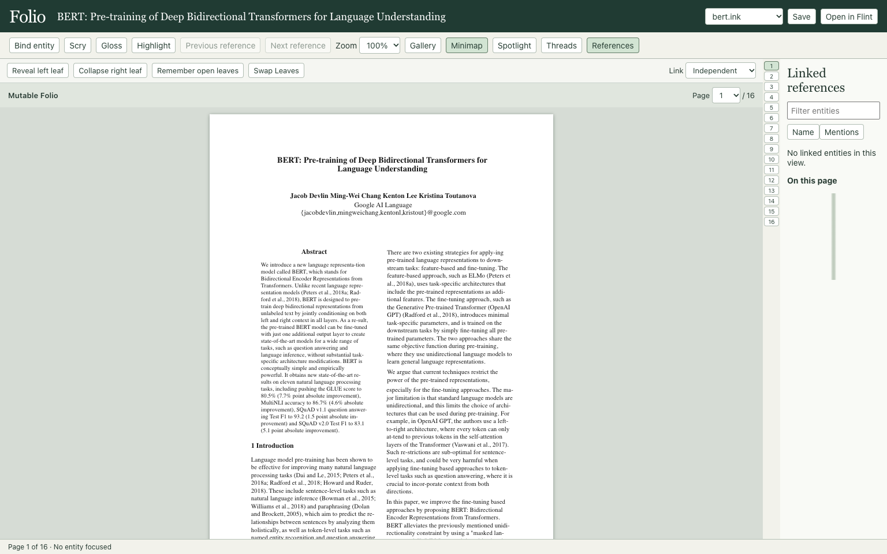
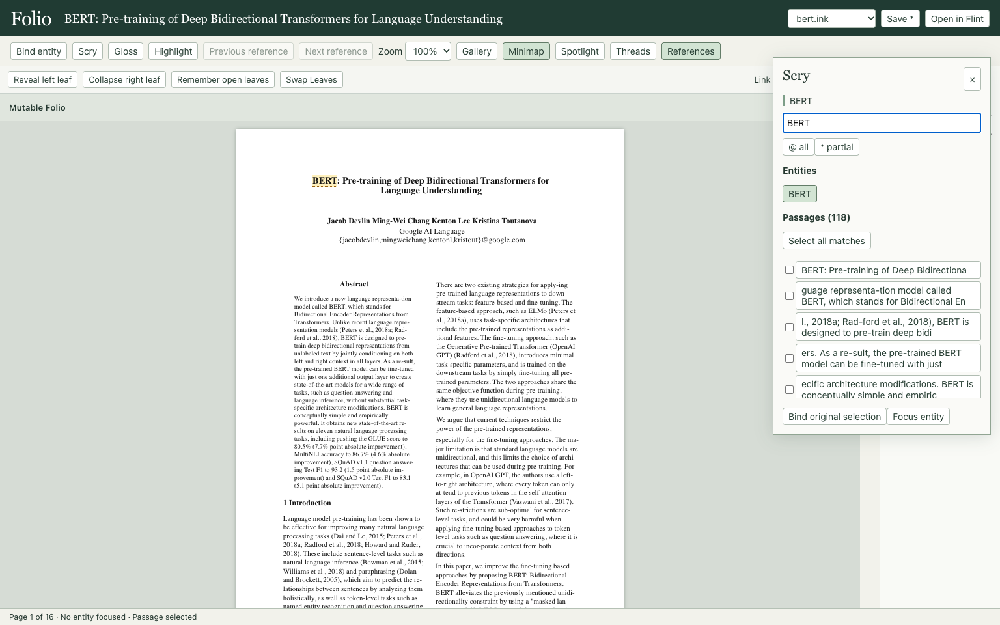
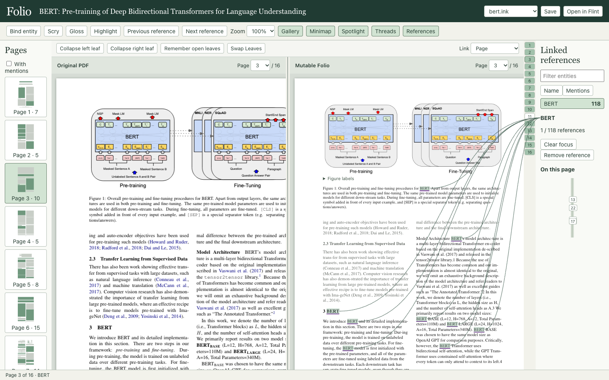

# Folio III — Semantic reading in a native publication

## Result

Folio opens one Ink file containing the original-source Leaf, an editable publication Leaf and the composition that places canonical passages on pages. A reader can select words on the reconstructed page, open Scry, bind passages to an existing Vault entity, write a Gloss and follow references through the publication. Flint opens the same live Document in continuous form. Chrome qualification used the 16-page BERT publication and then reopened it under a different filename. [Native BERT document](experiments/folio/iii/generated/bert.ink) · [Browser qualification](experiments/folio/iii/verify.mjs)



## Native structure and mounted behaviour

A Spread owns two ordinary child placements. Each targets a native `leaf-block` with a persistent ID, a physical `placement` of `verso` or `recto`, and an optional `collapsedByDefault`. A Leaf can be empty or hold multiple heterogeneous blocks. Import wraps earlier direct occupants into Leaves. The first goes in the first Leaf and every remaining occupant stays in order in the second. Mixed structures, duplicate sides, detached Leaves and identity collisions are rejected. Repository admission checks the affected owners and final pair before publication. The resident text-splice path bypasses structural validation. [Migration and admission](src/block-tree/spread.ts) · [Invariant tests](src/block-tree/spread.test.ts)

Swap writes both placements in a single history transaction. The view iterates the two ownership slots in stable order and sets CSS grid columns from the placements. Gutter width belongs to the physical left column. The keyboard order follows the stable ownership order after a swap. The labels on the Leaves and reveal controls follow their physical position. Bindings authored here store the persistent publisher and subscriber IDs. A collapsed Leaf releases its viewer and lease, and the occurrence remembers its page and proportional position for reveal. The source reader can retain one digest-verified PDF of up to 8 MiB. PDF.js receives a disposable byte buffer. [Spread view](src/rendering/spread-block.tsx) · [Gateway](src/runtime/leaf-events.ts) · [Readers](experiments/folio/ii/leaves.jsx)

The browser test retains references to both actual Leaf elements, the publication sheet and the original PDF canvas, then compares object identities after swap. The existing gateway tests also cover isolation, compatibility, stale leases, coalescing and feedback. Page linking requires the identical PDF pagination digest. The existing version-one progress contract measures scroll fraction within the current page. A future whole-content reader needs a separately negotiated domain before it can advertise document-relative progress. [Gateway regressions](src/runtime/leaf-events.test.ts) · [Two simultaneous spread occurrences](src/rendering/spread-block.test.tsx)

## Open, manual Save and assets

One native Document owns the Spread, its Leaves, the canonical TextBlocks and ImageBlocks, document-owned annotation definitions and physical frame metadata. Flint renders the continuous publication child of the Spread. It does not index a second copy of the PDF text. Folio and Flint share workspace commands, undo history, the dirty indicator and manual Save. Page choice, zoom and semantic focus are session state. Command-S or Control-S targets the open file. [Continuous presentation](src/rendering/folio-manifestation.tsx) · [Reader application](experiments/folio/iii/viewer.jsx)

The source PDF and raster figures have Cavern-scoped SHA-256 identities. Chrome used the native Vault relocation operation, reopened the newly named publication and resolved both its PDF and its 1,216-pixel BERT figure. Entity counts and Glosses survived. Across Caverns, the destination needs the corresponding managed assets and identity mapping. An Ink file alone carries the references. A missing source leaves the publication readable and the source pane reports the failure. A figure read failure offers a local retry. [Managed store and host](experiments/folio/iii/serve.mjs) · [Native relocation test](experiments/folio/iii/verify.mjs)

## Direct semantic reading

The reader translates a DOM selection into versioned, half-open native text ranges. It checks UTF-16 boundaries against grapheme boundaries, maps frame-local offsets to canonical code points, and joins adjacent segments of the same TextBlock. A selection can span visible logical blocks. Native validation runs again before authoring. The single-page renderer restricts a drag to the current page. Gloss accepts one contiguous logical block and uses the existing draft controller, parser, authoring operation and Enter-to-commit behaviour. A highlight uses the native range annotation command. [Selection adapter](experiments/folio/iii/ranges.mjs) · [Gloss controller](src/features/gloss/controller.ts)

Scry retains the original selection while the query changes. The Folio dialog uses the existing LER session, canonical name/alias/mention lookup, document TextSearch and native single or batch binding commands. It supports field and match controls, passage preview, individual candidates, Select All and focus without authoring. Query editing accepts literal punctuation. Command mode exposes matching-field and exact/partial shortcuts. The dedicated reading dialog implements a subset of the full Flint workstation. Chrome exercised a changed query, single bind, undo and a batch of 118 logical BERT mentions. [Scry adapter](experiments/folio/iii/scry.jsx) · [Native inventory](src/features/entity-references/document-entities.ts)



The Linked Entity References inspector reuses DocumentEntityList for inventory, native change subscriptions, mention counts and sorting. The reader resolves each logical mention through its property identity and current range when locating it. Clicking an entity in the inspector or the page pins the shared entity focus. Previous and next visit individual mentions. Green shading shows the focused occurrences and an amber preview identifies the navigated passage. Removal is an authored native operation. The minimap locates references approximately from their frame position; several in one paragraph can coincide. The spine displays page counts in its labels and marks pages with mentions. The gallery renders up to eight lightweight layout diagrams at a time and supports a pages-with-mentions filter. Spotlight dims surrounding text while preserving the page. [Reader controls](experiments/folio/iii/viewer.jsx)



## Threads and retrieval

Mounted spatial frames register with an occurrence-local geometry cache. Focus and passage previews use the editor's temporary decoration owners and its SVG region renderer. Geometry measurements are made in a scheduled read phase for invalidated frames and reused for highlights and Thread endpoints. The overlay clips endpoints to their viewport and the stage. Scrolling with Threads enabled can reposition endpoints without remeasuring glyph ranges. Collapsing a Leaf or changing page removes its registered frames. The browser check disables Threads, scrolls and asserts that the Thread frame counter stays fixed. [Geometry adapter](experiments/folio/iii/geometry.jsx) · [Reusable resolver](src/features/folio/threads.ts)

Native entity bindings supply the live inspector-to-mention connections. The source PDF participates in compatible navigation. Matching page numbers alone cannot establish a semantic correspondence. PDF lexical candidates, pronoun resolution and explicit passage-to-passage correspondence remain separate future endpoint sources. No source-run alignment is maintained during reading or editing.

The contribution demonstration is **synthetic**. It renders a labelled contribution beside an actual passage read from the native BERT abstract, with a dashed, unverified AI-attributed evidence line. Both views use the same endpoint resolver. The fixture has no retrieval run, model exchange or human review. The resolver test also removes the connection when an endpoint falls outside the viewport. [Open the fixture on the local host](http://127.0.0.1:4176/experiments/folio/iii/thread-fixture.html) · [Fixture source](experiments/folio/iii/thread-fixture.html) · [Resolver test](src/features/folio/threads.test.ts)

The repository's retrieval service already stores a saved resource hash and passage spans with document, block, occurrence, coordinates and text hash. Hybrid search exposes rank, BM25 and vector signals. Dialectic records exchange tool activity and checks a current native source before issuing a fresh handle. A future citation renderer should resolve a recorded result against its source hash and range, show the run separately from a participant's evidence or counter-evidence attribution, then display any subsequent human review. Scores alone establish neither evidential support nor review. No new persistence schema was added for the overlay. [Retrieval store](src/retrieval/store.mjs) · [Passage planner](src/retrieval/passages.mjs) · [Dialectic retrieval qualification](src/features/dialectic/dcp/retrieval.test.ts) · [Concept explainer](animated-explainers/episodes/011-rags-to-riches/retrieval.tsx)

## Import qualification

The five new PDFs were pinned by SHA-256 before first-pass extraction. They cover digital-humanities software, textual criticism, historical chronicles and historical OCR evaluation. All five are born-digital articles. The OCR paper tests importing the article about OCR. The importer used the same reconstruction policy across the five, with no per-paper repair. The table counts are parser candidates. Their tokens are retained as reading text where the structure is uncertain. Extraction coverage counts the parser's items, so it cannot establish that all source graphics or reading relationships were recovered. [Pinned sources and importer](experiments/folio/iii/import.mjs) · [Initial counters](experiments/folio/iii/evidence/import.json) · [Browser measurements](experiments/folio/iii/evidence/sample-pages.json)

| Publication | Pages | Mapped items | Images / caption candidates / table candidates | Sample finding |
| --- | ---: | ---: | ---: | --- |
| [Potnia](experiments/folio/iii/evidence/potnia-comparison.jpg) | 6 | 431/431 | 9 / 3 / 0 | Page 2 preserves the introductory prose and following bullet order. Text wraps farther down the sheet. |
| [teiphy](experiments/folio/iii/evidence/teiphy-comparison.jpg) | 10 | 919/919 | 10 / 2 / 3 | Page 3 preserves the prose–Design–prose sequence, although the final letter of “Design” wraps onto a new line. The parser recovered 48 items outside its initial grouping across the publication. |
| [corporaexplorer](experiments/folio/iii/evidence/corpora-comparison.jpg) | 3 | 255/255 | 4 / 1 / 0 | Page 2 retains the software illustration and following caption. Narrow heading frames wrap, and “docu-ments” retains a print line-end hyphen. |
| [Dutch chronicle](experiments/folio/iii/evidence/chronicle-comparison.jpg) | 14 | 1,832/1,832 | 5 / 13 / 13 | Page 4 preserves Table 2's text and caption but loses the grid. Two-column numbered prose and typographic emphasis remain recognisable. |
| [Historical OCR quality](experiments/folio/iii/evidence/newspapers-comparison.jpg) | 6 | 725/725 | 3 / 3 / 1 | Page 2 retains both columns, the heatmap and its caption. Print hyphens recur inside words in continuous reading. |

None of the sampled native pages had a text frame overflowing horizontally. Each source page was about 842 points tall. Native sheet heights on those five samples were 903, 880, 954, 842 and 850 CSS pixels at 100%. Footnote candidates come from position and type size. The artifacts retain bibliography text, emphasis and caption candidates; footnote anchors, general figure–caption linkage, bibliography segmentation and table precision have no corpus-wide ground truth here. Vector artwork can lose strokes or graphical structure. BERT Figure 1 uses an explicitly reviewed source crop. Its 192 DPI derivative was 103,847 bytes and took about 142 ms to render and store during import. Earlier 96 DPI output was 608 pixels wide. [Reviewed crop and import measurements](experiments/folio/iii/evidence/import.json)

## Performance and regression evidence

The standalone Chrome Flint benchmark typed into both BERT editions and restored the original text. Folio II recorded 1.7 ms median synchronous input and 5.9 ms p95; Folio III recorded 0.8 ms and 2.8 ms respectively. Each run counted zero repository snapshots, service requests and worker starts. These are two measured trials on one machine. They do not establish a general latency improvement. [Paired timings](experiments/folio/iii/evidence/typing.json) · [Reproduction driver](experiments/folio/iii/typing.mjs)

The reader workflow measures native Open to the second animation frame and records driver elapsed times through visible changes. These include automation, browser scheduling and, for Save, server work. In the final run, Open took 1.48 s, first PDF reveal 3.25 s, repeat reveal 640 ms and manual Save 11.69 s. Save was the slowest authored operation. Swap took 74 ms, focused distribution 70 ms, reference navigation 66 ms, gallery display 82 ms and enabling Threads 66 ms. Single binding took 86 ms and the 118-mention batch took 112 ms. Twenty-four wheel gestures produced 24 gateway deliveries in 880 ms. The test compared both ends of each visible Thread with actual highlight and inspector rectangles after zoom, resize, swap and undo. It checked stable mention identities across native relocation and reopen, and observed zero save requests during transient navigation. [Browser measurements](experiments/folio/iii/evidence/browser.json)

The focused Vitest runs passed 148 tests across native persistence, Leaf structure, retained gateway leases, Threads, entity inventory and Gloss. The Unicode continuation test and both TypeScript projects also passed. With Flint and the spatial reader open together, five typed characters touched one spatial TextBlock. The measured interval included zero full projection builds, snapshots, semantic distribution rebuilds or API requests. Splitting a paragraph exposed its unplaced continuation; joining restored the original text. [Browser driver](experiments/folio/iii/verify.mjs) · [Frame-boundary regression](experiments/folio/iii/ranges.test.mjs)

## Reproduce

From the repository root with the project's Node environment, a Chrome installation and the repository dependencies installed, run:

```sh
npm ci --prefix experiments/folio
node experiments/folio/iii/import.mjs
node experiments/folio/iii/serve.mjs
```

Open [Folio](http://127.0.0.1:4176/experiments/folio/iii/). The default host seeds a local reading Vault with the eight publications and managed assets. The five fresh PDF downloads are hash checked. Starting the host again preserves authored files in the Vault. To use an existing native Vault, set `FOLIO_VAULT` and `FOLIO_CAVERN_ID` to its location and managed asset context. This skips sample import and entity seeding. The reader is available through this dedicated local host; the desktop launcher does not yet register a Folio application icon. [All native publications](experiments/folio/iii/generated) · [Host](experiments/folio/iii/serve.mjs)

```sh
node scripts/build-relocation-helper.mjs
node experiments/folio/iii/verify.mjs
node experiments/folio/iii/inspect-imports.mjs
node experiments/folio/iii/typing.mjs
node --test experiments/folio/iii/ranges.test.mjs
npx vitest run src/block-tree/spread.test.ts src/features/folio/threads.test.ts src/rendering/spread-block.test.tsx src/runtime/leaf-events.test.ts src/application/document-entity-changes.test.ts src/features/gloss src/persistence/native-resource.test.ts src/features/entity-references/document-entities.test.ts src/features/entity-references/document-entity-list.test.tsx
npm run typecheck
```

The workflow test creates a temporary Vault. The five-page comparison driver reads the running demo host. Keep the representative native files and review evidence in version control. The much larger download, asset-staging, Vite and benchmark working directories live under the ignored `experiments/folio/work/`.

## Limits and next steps

Direct spatial typing, automatic pagination, full concertina, cross-Cavern export packaging and live RAG evidence adjudication remain deferred. Word-aware continuation breaks choose nearby legal boundaries and preserve the remaining graphemes in the final frame. A newly inserted logical block without a frame is reported in the reader and available in Flint. Arbitrary layout edits can still need human assignment of frames. A useful next import milestone is a human-labelled sample of footnotes, tables, vector figures and line-end hyphens across unfamiliar publishers. The next integration milestone is an ordinary desktop Open-in-Folio action that supplies the existing Vault and entity services to this reader.
