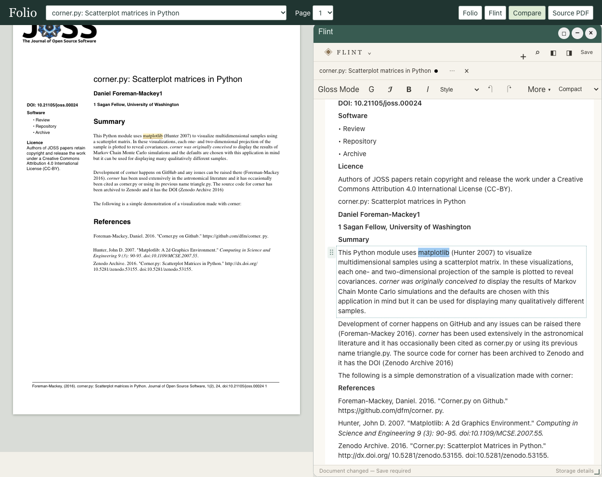
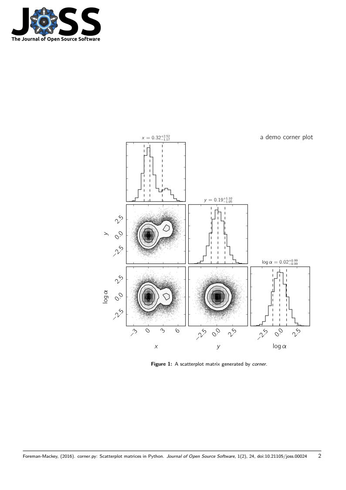
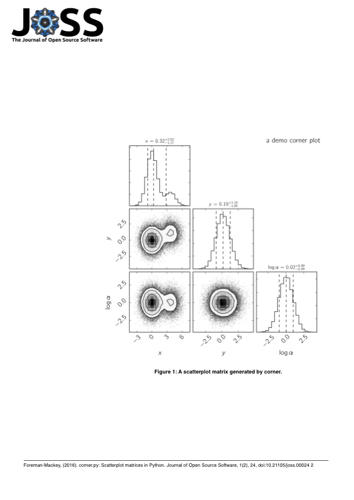
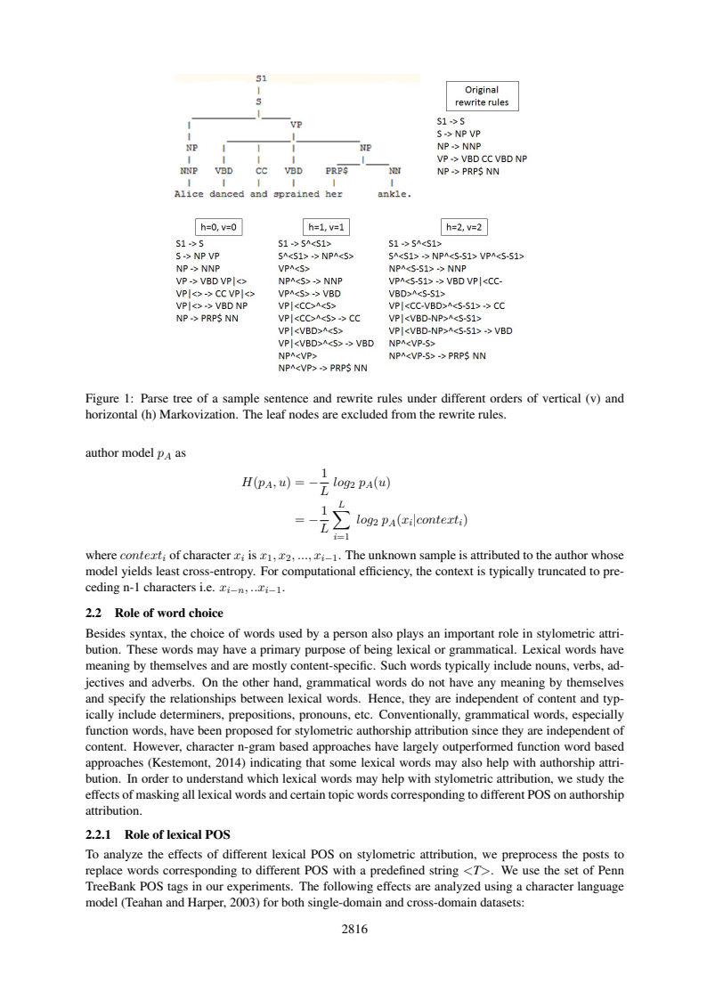
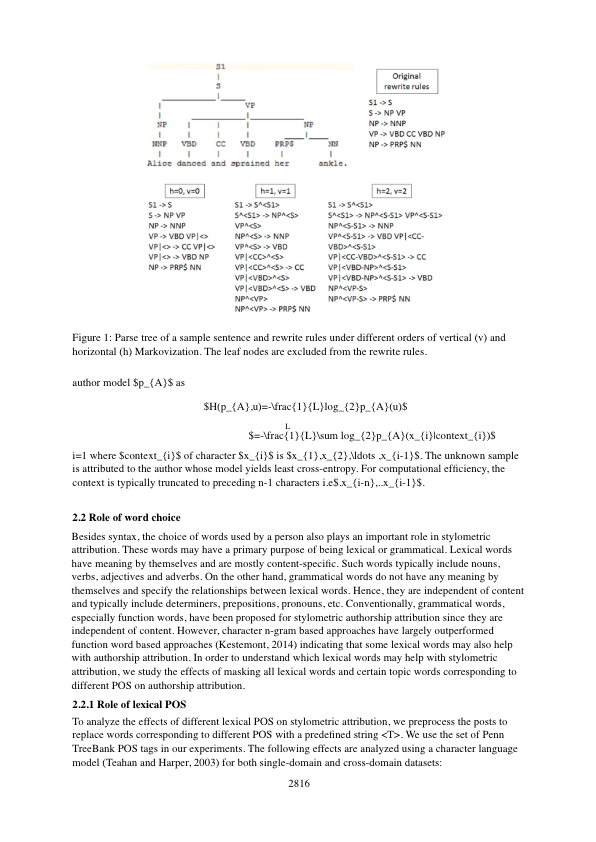
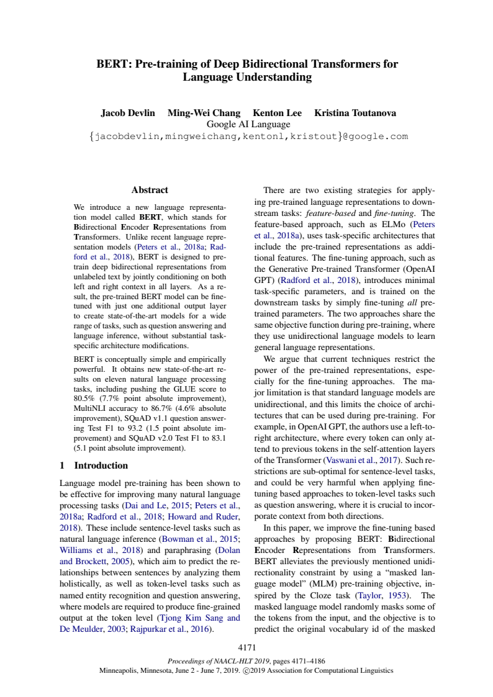
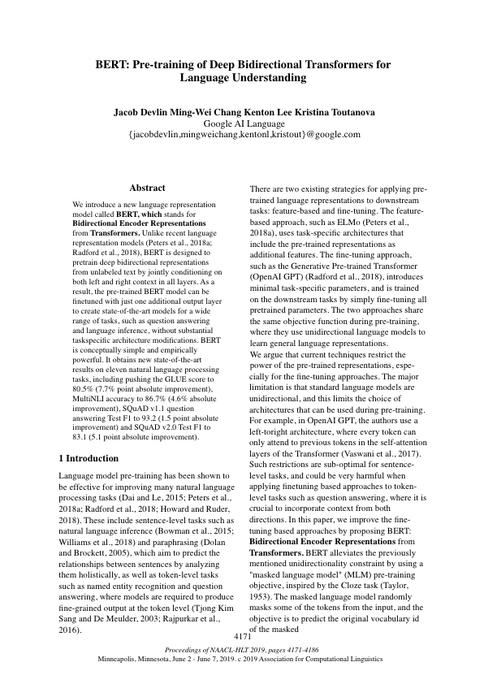
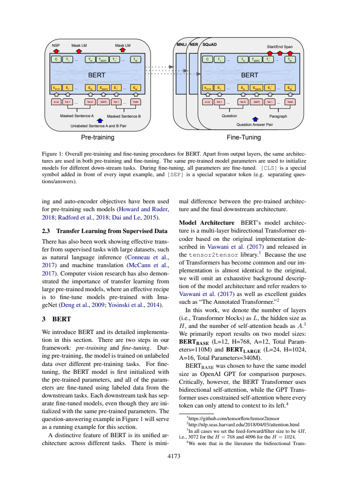
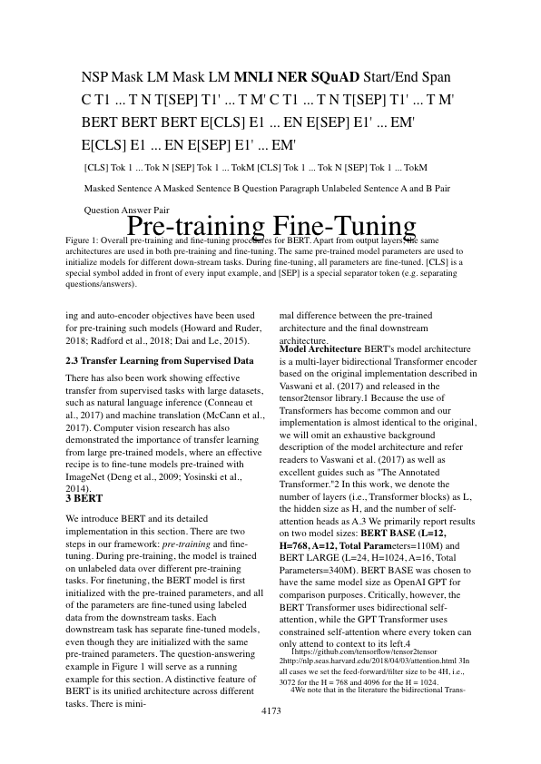

# Folio spatial standoff investigation

27 November 2026 · Mutable OS · Experimental prototype · Repository baseline `57e442e`

## Feasibility verdict

**Proceed with a second experiment on source mapping and editorial review.** A born-digital paper can become one editable Mutable document with a recognisable spatial edition. All three publications opened in Flint. On the JOSS paper, selecting *matplotlib* in Folio located the same nine characters in Flint. Creating a Gloss there marked the passage in both views immediately. Manual Save persisted its document-owned definition and range in the opened Ink file. The PDF and its source coordinates survived independently. [Saved annotated document](experiments/folio/evidence/corner-annotated.ink) · [Browser checks](experiments/folio/evidence/browser.json)



**LiteParse is a viable primary extractor. Its inferred structure needs review.** The native importer accounted for all 4,475 returned text items across 27 pages. That measures coverage of the extraction. Comparing the resulting text with independent author and publisher text exposed lost lexical hyphens. The double-column introduction reads down the left column before continuing on the right, yet a few lines of its prose were classified as a table. In the BERT architecture diagram, text labels survived while the connections giving them meaning disappeared. Those are material differences for scholarly annotation and retrieval. [Passage comparisons](experiments/folio/evidence/passages.json) · [BERT source page](experiments/folio/evidence/bert-p3-source.png) · [Reconstruction](experiments/folio/evidence/bert-p3-folio.png)

The experiment lives in [experiments/folio](experiments/folio). Its separate entry point opens a private demonstration vault. It adds no application registration, parser dependency or typing subscription to the production editor.

## Corpus and measurements

All three PDFs and their SHA-256 identities are retained. The derivatives and screenshots are experimental adaptations. The JOSS PDF declares CC BY 4.0, the COLING paper states that licence on page 1, and the 2019 ACL paper falls under the publisher's post-2016 CC BY 4.0 policy. The COLING PDF title reads *What constitutes “style”…* while its catalogue entry says *What represents “style”…*. The native title follows the PDF. [Corpus manifest](experiments/folio/corpus.mjs) · [ACL rights statement](https://aclanthology.org/faq/copyright/) · [CC BY 4.0](https://creativecommons.org/licenses/by/4.0/)

| Publication and coverage | Pages | Native text blocks | Source items | Image placements | Extract | Convert, validate and write | Open to spatial frame |
|---|---:|---:|---:|---:|---:|---:|---:|
| Daniel Foreman-Mackey, *corner.py* (2016). Single main column, marginal licence, bibliography and a scatterplot. [JOSS](https://joss.theoj.org/papers/10.21105/joss.00024) | 2 | 21 | 67 | 3 | 112 ms | 35 ms | 100 ms |
| Kalaivani Sundararajan and Damon L. Woodard, authorship attribution (2018). Single-column prose, a parse tree and caption, foot-of-page licence note, equations and tables. [COLING](https://aclanthology.org/C18-1238/) | 9 | 115 | 942 | 7 | 117 ms | 127 ms | 125 ms |
| Jacob Devlin, Ming-Wei Chang, Kenton Lee and Kristina Toutanova, *BERT* (2019). Double columns, numbered footnotes, diagram and bibliography. [NAACL](https://aclanthology.org/N19-1423/) | 16 | 374 | 3,466 | 0 | 288 ms | 330 ms | 309 ms |

Times are individual elapsed measurements on an Apple M1, Darwin arm64, Node 22.12.0 and local headless Chrome 158. The parser ran sequentially in one process. Conversion includes asset writing, mapping checks, gzip, native encoding and a decode/re-encode equality check. The browser measurement starts after module loading and ends at the second animation-frame callback after native Open and spatial mount. Switching to Flint took 897 ms for the COLING paper and 1,819 ms for BERT, including browser automation. A first meaningful paint on a user's workstation may differ. [Import measurements](experiments/folio/evidence/import.json) · [Browser measurements](experiments/folio/evidence/browser.json)

## Extraction engine

Tested `@llamaindex/liteparse@2.21.3`, npm's current version during the investigation, with its matching native binary and bundled PDFium library. The import uses local PDF bytes. OCR was explicitly disabled, small text retained, and block, text metadata, raster, vector and structure extraction enabled. The Node API supplies typed objects, including `pages[].textItems`, `pages[].blocks` and document-level `images`. Block text can contain Markdown or math syntax. Folio consumes the item strings and uses the block classifications as hypotheses. [Pinned implementation](https://github.com/run-llama/liteparse/tree/node-v2.21.3) · [Extraction options](https://developers.llamaindex.ai/liteparse/guides/extraction/) · [Executed importer](experiments/folio/import.mjs)

| Capability | Result in this investigation |
|---|---|
| CLI and bindings | The proposed CLI flags were accepted. With npm's `lit parse --format json --extract-blocks`, the written page contained text and items but omitted `blocks`. On BERT page 1 the Node API returned 18 blocks even with JSON output selected. Use the binding for the adapter. The full importer also requests Markdown so the independently reconstructed strings can be inspected. [Release CLI](https://github.com/run-llama/liteparse/blob/node-v2.21.3/packages/node/src/cli.ts) · [Probe output](experiments/folio/evidence/parser-probes.json) |
| Native text and order | Items have a page-local index, text, top-left viewport box in 72 units/inch, rotation and font data. Classified blocks have ordered page membership and usually a list of indices. Interleaved item-array order on BERT page 1 would mix columns. Grouping by classified block recovers the broad reading order. JOSS marginal metadata precedes the title in Flint because the parser reads the left sidebar first. |
| Fonts and symbols | Font names, sizes and weights distinguish headings, body and small notes. Some merged items carry the leading font across a style change. JOSS's figure caption is one item with the leading bold font. The reconstructed run therefore overstates emphasis. An affiliation superscript can become an ordinary digit appended to the author. Exact glyph placement and sub/superscript semantics remain uncertain. |
| Tables | The API returned 20 table candidates containing 708 candidate cells. No cell in this corpus had a nonempty item-index list. Some cell boxes had zero width. Of 797 items outside explicit block membership, unique geometric containment in a table candidate recovered 796. One BERT item was retained separately. This recovers text and provenance, with no claim to trustworthy row, column or reading order. [Actual candidate cells](experiments/folio/evidence/parser-probes.json) |
| Raster figures | Extracted bytes carried intrinsic dimensions, placement and rotation. Ten placements became native ImageBlocks, using nine distinct image payloads. The JOSS scatterplot and COLING tree landed above their captions. A document with zero image errors can still have an unreconstructed figure. |
| Vector figures | BERT page 3 yielded 187 shape summaries and 590 line records, plus separate label text. Curve presence, stroke, fill and bounding boxes are insufficient to replay the drawing. A targeted PDF.js 5.4.624 probe on that page saw 190 path-construction and 14 image-paint operations. A page-region crop rendered by PDF.js merits testing as a figure fallback. Correct crop selection, reading order and caption linkage still require evidence. [Probe](experiments/folio/probe.mjs) |
| Tagged PDF | The 27 publication pages returned zero structure roots. A separately generated tagged control returned H1 and P roots with marked-content IDs 0 and 1 matching the two text items. Authored tags and MCIDs can supply stronger evidence when present. [Positive control](experiments/folio/evidence/parser-probes.json) |
| OCR, deployment and licensing | The package declares Node 18+ and Apache-2.0. This run used the Darwin arm64 N-API package. Other native targets are listed in the lockfile. Browser WASM, Tesseract and the optional OCRia-nano pipeline were outside the measurement. OCRia-nano weights have a separate modified OpenRAIL licence and require a model pull for local use. A native worker with page/byte budgets and cancellation would keep parsing outside the UI and allow an explicit choice for image-only pages. [Installation](https://developers.llamaindex.ai/liteparse/getting_started/) · [OCR configuration](https://developers.llamaindex.ai/liteparse/guides/ocr/) · [Model information](https://developers.llamaindex.ai/liteparse/) |

## Reconstruction and fidelity

**Method.** Start with the block list in reading order. Assign each item once. Record inferred memberships separately, retain unclassified ink, and move bottom-margin furniture after both columns where the frame position identifies it. Group nearby baselines within each block and sort fragments horizontally. Merge adjacent prose fragments only when column origin, baseline step, size and an unfinished sentence agree. Separate unusually large line gaps. Join physical lines with explicit synthetic separators, normalise selected ligatures and Unicode composition, and conditionally remove a line-final hyphen when the parser's joined reading supports it. The independent comparison shows why that last decision needs a confidence flag. [Reconstruction source](experiments/folio/reconstruct.mjs)

**Textual accuracy.** The author's first JOSS summary paragraph matched all 75 reference tokens in order after expanding the manuscript citation to its printed form. The COLING abstract had one difference across 275 reference tokens: *single-domain* became *singledomain*. BERT's 220-token reference abstract had three hyphen differences and two extra percent signs relative to the catalogue transcription. The percent signs illustrate that catalogue text can itself differ from the publication. The comparison case-folds, uses NFKC and counts punctuation as tokens. It qualifies those three passages only. The source coverage assertion separately checks every paragraph, including inserted spaces and the half-open to inclusive range conversion. [Pinned comparison inputs and differences](experiments/folio/evidence/passages.json) · [Comparison program](experiments/folio/compare.py)

**Logical structure.** Headings, body, captions, references and page furniture survive as native text. Author affiliations can be labelled as headings. On BERT page 1 a spurious table splits *especially* between two text blocks. On page 3, footnotes 2 and 3 occur inside a common parser block. Their text remains inspectable, but the callout-to-note edge is unknown. Physical columns and pages still split some logical paragraphs. A reviewer needs to be able to join or separate them while keeping their several source regions. Bibliographic entries likewise need explicit boundaries before citation resolution.

**Composition.** The native spatial view mounts only the selected page. Each text frame reads a canonical TextBlock and composes ordinary HTML spans. The browser shapes and wraps the text. Frame origin and width, median font size, estimated leading, family classification and alignment initialise the edition. Single-line frames keep their intended line. Raster ImageBlocks and simple horizontal rules use independent placements. The source PDF opens at the selected physical page. Body and figure geometry are recognisable. Width and height drift, false groupings, missing visual material and flattened math remain visible in the examples. On the three sampled pages, 0/2, 0/11 and 2/13 text frames respectively exceeded their original height by more than one composed line. This diagnostic does not detect horizontal overflow, rule intersections or semantic errors. [Spatial view](experiments/folio/viewer.jsx) · [Measured pages](experiments/folio/evidence/browser.json)

| Page and observation | Original | Native composition |
|---|---|---|
| JOSS p. 2. The scatterplot, logo, caption and page furniture retain their positions. | [](experiments/folio/evidence/corner-source.png) | [](experiments/folio/evidence/corner-folio.png) |
| COLING p. 3. The parse-tree image and caption survive. Formula fragments below the figure lose their typesetting. | [](experiments/folio/evidence/style-source.png) | [](experiments/folio/evidence/style-folio.png) |
| BERT p. 1. The title band, inset abstract and two columns remain identifiable. Font substitution changes wrapping and the final lines approach the footer. | [](experiments/folio/evidence/bert-source.png) | [](experiments/folio/evidence/bert-folio.png) |
| BERT p. 3. Diagram labels survive in a cluster of text, the arrows and coloured structure disappear, and the caption collides with the drawing's title. This region needs explicit figure treatment. | [](experiments/folio/evidence/bert-p3-source.png) | [](experiments/folio/evidence/bert-p3-folio.png) |

## Spatial standoff and source-to-text mapping

The prototype uses three independently addressable records.

| Record | Prototype representation | Identity and editing semantics |
|---|---|---|
| Documentary evidence | Original PDF and a compressed extraction resource. Each page holds original dimensions, item strings and boxes, font observations, classified blocks, physical lines, figure placements, vector metadata and mapping records. | The document carries a PDF SHA-256 and a digest of the **uncompressed** evidence JSON. Page and item indices are scoped to this extraction. A new parser or source version needs a new evidence identity. Trace verifies the digest on demand. |
| Logical content | Native Document → Pages → StandoffEditorBlocks and ImageBlocks. Text atoms, typographic properties and document-owned Gloss definitions use existing native encoding. | The authored Block ID and document identity survive Save/Open. Inclusive native code-point segments associate a live range with its source item. Document-owned definitions can associate several segments with one semantic identity. |
| Composition | Initial frame, family, size, leading, line count and alignment live in a separate `metadata.folio` record. Page geometry and rule placements belong to the page. | Changing a frame should affect the selected edition alone. The spatial renderer reads only composition and live content. Source geometry remains available after a restyle or text edit. Tracing a selection makes an explicit read of the immutable resource. |

**One concrete mapping.** JOSS page 1 item 10 occupies approximately `(166.5, 258.6, 386.3, 10.5)` points in top-left coordinates. At import it owns code points `[0,86)` of the first summary paragraph. The following join space at 86 has no source glyph. Selecting *matplotlib* returns item 10 and its entire box. Farther along, item 14 ends in *pro-* and item 20 begins the next line. The removed hyphen is still in the source string, and the output intervals meet at code point 173. The word *projection* thus has two documentary regions. The map records item-level transformations and original text. It does not assert a precise sub-item rectangle for every character. [JOSS source evidence](experiments/folio/generated/corner.source.json.gz) · [Saved trace](experiments/folio/evidence/browser.json)

**Proposed general model.** Give a source region a versioned resource identity, surface ID, coordinate system, geometry and optional transform. Keep extraction-run identity separate from PDF version, since indices can change between extractor releases. Express correspondence as a list of edges between logical segments and region IDs. Each edge can record source-character and output-code-point intervals, operation, confidence and origin method. An expansion can map one source glyph to two logical code points. A deleted hyphen can have an empty output interval. An inserted separator can have an empty source interval. Several edges can address the same figure region, and one discontinuous claim can reference several pages. When word boxes are available, refine a selected edge on demand. Page viewport space, PDF user space and current CSS coordinates need named, invertible transforms including crop and rotation.

Use range properties for semantic meaning, emphasis and explicit textual anchors. Store physical lines, image or graphic regions and their transforms in the source resource. Represent text frames, columns, margins and image placement as versioned layout objects with their own IDs and a link to the logical block or range. Represent font size, spacing, alignment and substitute family in the composition profile, with inline exceptions in ordinary standoff styles. Treat a table as a candidate grid with cell geometry and textual links until reviewed. This also accommodates a born-native layout with no PDF, a facsimile/OCR source, or a large-print or translated composition sharing semantic identities.

**Edit policy to qualify.** At import the baseline map is exact at the stated item granularity. Native anchors rebase through ordinary edits, but inserted text within an old range is an editorial addition. A surviving anchor records derivation from a region. Current characters may include editorial additions. Full deletion can consume the live segment. The documentary item and its baseline interval remain. Use source-versioned baseline maps, a bounded block-local change map and sparse live anchors for explicitly cited ranges in the next experiment. Exercise changes at both boundaries, replacement, split/join, deletion, structural moves, Undo/Redo and Save/reopen. Cross-page composition needs range-to-frame links independent of physical Page ownership. Ambiguous realignment should retain the last verified source citation and expose uncertainty.

## Fit with existing Mutable infrastructure

| Capability | Reuse or adaptation |
|---|---|
| Flint, Cells and identity | Use Flint for editing, selection, IME, Undo/Redo and manual persistence. The prototype hands a single-block DOM selection across as Unicode code-point boundaries, rechecks the selected text, and calls the Flint mount's selection API. Occurrence-local DOM or transient Cell keys are unsuitable persistent source IDs. Compact canonical text can store whole spans, while an editing occurrence materialises character addresses. [Character addressing](src/rendering/character-address.ts) · [Inline sequence](src/block-tree/inline-sequence.ts) · [Resident Cells](src/block-tree/resident-cells.ts) |
| Standoff, Gloss, Claims, Relationships and entity references | Existing linked annotations provide a document owner and separately editable segments across blocks. Folio demonstrated one native Gloss, including persistence of its ID, range and definition. Claim or entity types, graph edges, backlinks and Scry should consume canonical text and existing identities. Importing a citation string alone gives insufficient evidence to create a canonical Entity or Claim. Cross-block selection, entity highlighting in Folio, Scry queries, graph indexing and RAG were not exercised. Add Folio readers for registered semantic effects one type at a time. [Linked annotations](src/runtime/linked-annotations.ts) · [Gloss controller](src/features/gloss/controller.ts) · [Entity bindings](src/features/entity-references/bindings.ts) · [Scry navigation](src/application/scry-passage-navigation.test.tsx) |
| Native import, TEI and resource ownership | The importer uses the real block-tree decoder, resource capture and native envelope codec. Every output is decoded and re-encoded before it is accepted. The browser uses native Open into the object bank and the existing Flint application. TEI already demonstrates isolated preparation, diagnostic budgets, document-owned definitions and atomic admission. Its compact producer explicitly supports a limited set of TEI block types. A Folio adapter should reuse the generic native boundary and adopt the worker lifecycle. [Native resource codec](src/persistence/native-resource.ts) · [TEI importer](src/interchange/tei/README.md) |
| Pages, media and source resources | Existing PageBlocks and ImageBlocks carry native content and reflow in Flint. The prototype bundles PDF and image files next to the experiment. Image URLs depend on its local server path. Production portability needs the managed-asset lifecycle, source snapshot identity and a resolver on move/export. Existing PDF region anchors and academic OCR polygons supply precedents. PDF.js page derivatives currently record UTF-16 and source transforms. Convert units and coordinate origins explicitly when interoperating. [PDF derivative and anchor](src/pdf/model.ts) · [PDF.js viewer](src/pdf/viewer.ts) · [Academic derivative](src/academic/derivative.ts) · [Managed assets](src/interchange/managed-asset.ts) |
| Quill and layout | Quill already separates native text from versioned composition, typography, paths and graphic layers. Its SVG text paths suit diagrams, shaped titles and authored ornaments. CSS frames suit paragraphs because the browser supplies shaping, wrapping and text selection. Share viewport, transform and source-reference conventions with Quill before extending either schema. [Quill composition model](src/features/quill/model.ts) |
| Geometry and navigation | Immutable source boxes require no DOM measurement during typing or scrolling. The experimental view renders persistent semantic styles as spans and leaves Flint's caret, temporary ranges, annotation layers and layout caches in charge of the editing occurrence. Future transient range highlighting should use the existing decorations service and occurrence-relative geometry. The current source jump addresses a page and the trace yields item boxes. Reverse selection from PDF, transformed multi-page selections and live overlay synchronisation need separate qualification. [Flint decorations](src/rendering/decorations.ts) · [Shared layout invalidation](src/rendering/page-layout.ts) |

### Presentation choices

- **Fixed frames**, exercised here, preserve page landmarks and let one page mount independently. A substitute font can exhaust a frame or run a long line into its neighbour. A source-height comparison can flag some failures and costs nothing on the editor path when run as an explicit audit.
- **Constrained reflow** is the next candidate. Let a paragraph grow in its column and move subsequent frames down to the next explicit obstacle. Preserve caption groups and footnote reservations. If remaining column capacity is insufficient, mark the page for review. Invalidate only the affected flow and downstream dependencies.
- **Automatic pagination** would support large print, translation and alternate editions. It requires break decisions across logical paragraphs, widow/orphan policy, floats, footnote continuation and a stable mapping from many composition pages back to source pages. These decisions can follow a working reviewable import.

## Editing cost and safeguards

In Compare view, the JOSS test made one trusted text insertion with the actual Flint input gateway. Exactly one Folio frame reevaluated once. The test counted zero repository snapshots, whole-projection builds and API requests. It verified the dirty state, Undo/Redo text equality, and the persisted native Gloss after a manual Save. No Markdown file appeared in the test vault. The parser and native round-trip validation run only in the import process. Source-evidence decompression runs on an explicit trace. The selected composition page subscribes to its own children and text records. The full Folio page is unmounted in Flint-only mode. [Browser qualification](experiments/folio/verify.mjs)

The repository's real Flint benchmark compared identical BERT documents with the 3,466 `spatial/source-run` properties present or removed. Typography and text were held constant. It used compact canonical text and the normal Flint shell, with 40 edits per trial in a 1,311-character paragraph. The spatial renderer was absent for this comparison, which isolates the effect of storing the ranges. [Trial harness](experiments/folio/typing.mjs) · [Recorded measurements](experiments/folio/evidence/typing.json)

| Trial order | Source ranges | Synchronous median | Synchronous p95 | Settled p95 | Frame p95 |
|---|---|---:|---:|---:|---:|
| 1 | Removed | 0.8 ms | 2.1 ms | 2.2 ms | 46.5 ms |
| 2 | Present | 0.9 ms | 1.5 ms | 1.6 ms | 49.8 ms |
| 3 | Present | 0.9 ms | 2.4 ms | 2.6 ms | 47.3 ms |
| 4 | Removed | 0.9 ms | 1.7 ms | 1.7 ms | 48.1 ms |

An initial two-run pilot showed a larger difference while other browser work was running. The four sequential trials did not reproduce a consistent handler slowdown. All four restored the original text and counted zero snapshots, service requests and worker starts. Headless frame times include scheduling and cannot establish perceived typing latency. These runs cover one paragraph shape and one machine. They do not measure year-long editing, IME across scripts, or repeated splits of densely annotated text. Keep the bulky source evidence outside the authored payload and compare sparse anchoring on denser documents before selecting a production representation.

## Running and inspecting the experiment

From the repository root with its ordinary dependencies installed, use the checked-in native documents immediately or regenerate them from the PDFs. The experiment requires Node, the matching LiteParse platform binary and the repository's Vite tooling. Browser verification used locally installed Chrome. The comparison script uses Python 3, curl and network access for its pinned scholarly reference texts.

```sh
npm ci --prefix experiments/folio
node experiments/folio/serve.mjs
```

Open **http://127.0.0.1:4174/experiments/folio/**. Select a publication and page. **Folio** displays composed native text, **Flint** opens the real continuous editor, **Compare** displays both, and **Source PDF** opens the retained original at the selected physical page. Select text within one Folio frame and use **Trace to source** for the original item coordinates, or **Select in Flint** to carry the selection into Compare. Flint's Gloss tool accepts the selection. Save explicitly in Flint to keep edits.

The server seeds missing files in `experiments/folio/work/demo-vault` and preserves manual edits on restart. Generated fixtures stay in a separate directory. For a fresh verification, the script below creates and removes its own temporary vault. The isolated host enables the prototype by default. `FOLIO_EXPERIMENT=0` disables its launcher.

```sh
node experiments/folio/import.mjs
node experiments/folio/probe.mjs
python3 experiments/folio/compare.py
node experiments/folio/verify.mjs
node experiments/folio/typing.mjs
```

`import.mjs` verifies the pinned PDFs, fetching a missing original from its recorded URL. It regenerates the native documents, image resources, evidence and source screenshots. `probe.mjs` exercises the CLI, tagged control and PDF.js comparison. `verify.mjs` runs native Open, page comparison, selection transfer, Gloss creation, explicit save and bounded input checks. Set `CHROME_BIN` to a Chrome executable if the local installation is elsewhere. The last script runs the repository benchmark from the project root. Timings and newly authored Gloss IDs vary between runs.

| Publication | Original PDF | Native Mutable document | Representative extraction and map |
|---|---|---|---|
| JOSS | [PDF](experiments/folio/sources/corner.pdf) | [corner.ink](experiments/folio/generated/corner.ink) | [Excerpt](experiments/folio/evidence/corner-sample.json) · [Full evidence](experiments/folio/generated/corner.source.json.gz) |
| COLING | [PDF](experiments/folio/sources/style.pdf) | [style.ink](experiments/folio/generated/style.ink) | [Excerpt](experiments/folio/evidence/style-sample.json) · [Full evidence](experiments/folio/generated/style.source.json.gz) |
| BERT | [PDF](experiments/folio/sources/bert.pdf) | [bert.ink](experiments/folio/generated/bert.ink) | [Excerpt](experiments/folio/evidence/bert-sample.json) · [Full evidence](experiments/folio/generated/bert.source.json.gz) |

## Decision and next scope

**Minimum viable scope for a separately approved phase.** Support born-digital, horizontal single- and two-column articles, an explicit local import, one native logical text, retained source and extraction versions, paragraph/heading/caption review, source-page navigation, raster figures and a read-only spatial manifestation alongside Flint. Let the reviewer correct reading order, ambiguous joins and figure regions before promoting semantic relationships. Preserve unsupported material with a labelled link to the original region. Establish whether a verified diagram crop can represent the figure without duplicating its labels into reading order.

| Proposed increment | Estimated engineering effort | Evidence needed to advance |
|---|---:|---|
| Source resource, coordinate contract and durable mapping | 1–2 person-weeks | Versioned and rotated sources, synthetic joins, Unicode expansion, regional citations after edits and native save/reopen |
| Import worker and structural review | 2–3 person-weeks | Cancellation and budgets, no partial admission, held-out annotated pages, joined paragraphs across columns/pages, ambiguous table and note cases |
| Spatial view and bidirectional navigation | 2–3 person-weeks | Overflow diagnostics, stable figure and caption grouping, selection across occurrences, local geometry invalidation and an accessible continuous alternative |
| Compatibility and qualification | 1–2 person-weeks | Native asset portability, dense-source typing benchmarks, dirty state, history, multi-segment semantics and no unrelated index or Explorer updates |

**The estimate is 6–10 person-weeks**, assuming one engineer familiar with native admission and Flint, access to scholarly reviewers, and reuse of managed assets and existing annotation services. Desktop publishing, historical OCR, exact math reconstruction and PDF export would require separate estimates.

**Recommendation.** Proceed with the mapping and review experiment first. Promote a production import only after a reviewer can trace and correct the demonstrated hyphen, false-table and missing-figure cases on held-out publications, and a dense source map passes the editor's bounded-work checks. The native document and shared annotation model have earned that next experiment. Automatic reconstruction of publication-quality layouts remains unqualified.
