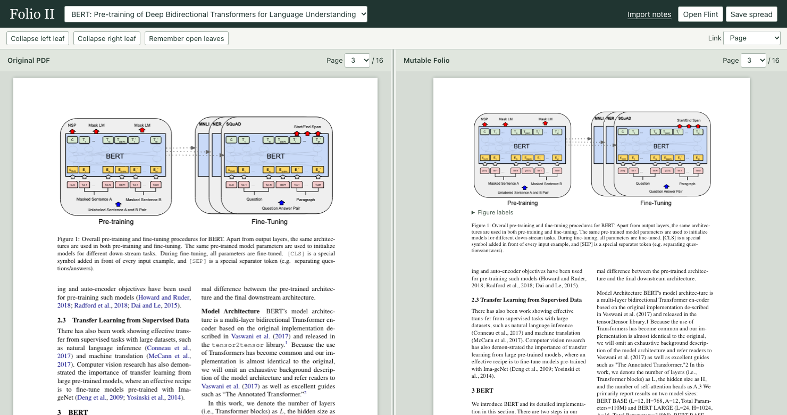
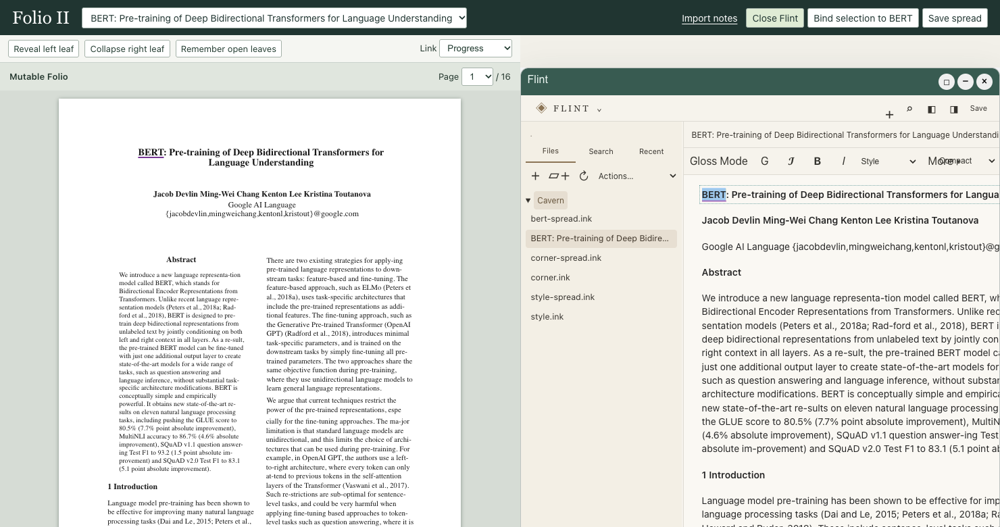

# Folio II implementation report

27 November 2026 · Mutable OS

## Executive summary

Folio II opens all three publications from the first investigation as native Mutable documents. In BERT, “the masked” at the bottom of page one and “word based only on its context” at the top of page two now belong to one editable paragraph. A browser test inserted text in Flint, read both spatial frames back, and recovered the complete edited paragraph exactly. A separate test bound the title’s “BERT” to an entity in an isolated SQLite vault. Both manifestations displayed the binding after manual Save and a fresh native Open. [Browser evidence](experiments/folio/ii/evidence/browser.json) · [Reproduction script](experiments/folio/ii/verify.mjs)

The general-purpose `spread-block` is registered behind the default-enabled `spreadBlocks` feature. The experimental Folio application supplies its first two navigation adapters. Its source Leaf starts collapsed, so opening the publication requires no PDF fetch or canvas. With both Leaves visible, page and proportional navigation worked in both directions. The sustained-scroll trial recorded zero repository commits, snapshots, full projection builds, API requests or graph sweeps. Opening BERT’s figure page did require one read of its managed image. [SpreadBlock view](src/rendering/spread-block.tsx) · [Gateway](src/runtime/leaf-events.ts) · [Browser measurements](experiments/folio/ii/evidence/browser.json)

### See the result





[Initial view with the PDF collapsed](experiments/folio/ii/evidence/initial.png) · [Folio I rendering of the same diagram](experiments/folio/evidence/bert-p3-folio.png)

## Publication and composition

Each publication has two native Ink resources. For BERT, `bert.ink` owns the paper’s editable text and the composition, while `bert-spread.ink` owns the comparison layout. The right occupant identifies the logical publication by resource ID. Both Flint and the Folio renderer read that publication’s live repository; editing one text block immediately updates its mounted frames. Separate workspace sessions give the layout and publication independent dirty state, undo history and opened filename. The experiment’s loader opens the selected publication and its matching layout together. [Publication](experiments/folio/ii/generated/bert.ink) · [Layout](experiments/folio/ii/generated/bert-spread.ink) · [Loader and manual save routing](experiments/folio/ii/viewer.jsx)

The publication directly owns ordinary StandoffEditorBlocks and ImageBlocks. Its ordered page records contain geometry, typography and frames that name logical blocks. A frame can select a half-open Unicode code-point interval. The final frame takes the remaining text. The importer checks that the slices of every logical text block meet exactly, start at zero and cover the entire block. Flint can therefore select and annotate across a physical break with its ordinary character identities. Existing linked, multi-segment annotations remain available for mentions that genuinely cross logical blocks. Folio I’s PageBlock ownership remains intact in the first edition. Quill supplies the precedent for a composition that refers to separately owned text. [Importer and coverage assertions](experiments/folio/ii/import.mjs) · [Native linked annotations](src/runtime/linked-annotations.ts) · [Quill example](src/features/quill/examples.ts)

Every original PDF is seeded into the repository’s immutable managed-asset store. The publication retains the SHA-256 identity, URL, title, authors, source ID, licence, original page numbers and an import evidence reference. The browser test fetched BERT’s original after editing and saving and recomputed the pinned digest. The first investigation’s compressed extraction captures remain available for independent inspection. All three new publications contain zero live source-run annotations. Navigation and typing have no dependency on those captures. [Corpus identities](experiments/folio/corpus.mjs) · [Managed resource setup](experiments/folio/ii/serve.mjs) · [Original capture example](experiments/folio/generated/bert.source.json.gz)

## Reconstruction results

| Publication | Physical pages | Logical text blocks | Native images | Verified detail |
|---|---:|---:|---:|---|
| Foreman-Mackey, *corner.py* | 2 | 21 | 3 | The bold prefix ends at “Figure 1:”. The following caption text uses body weight. |
| Sundararajan and Woodard, authorship attribution | 9 | 115 | 7 | The import preserves the lexical hyphen in “single-domain”. |
| Devlin et al., BERT | 16 | 370 | 1 | The import preserves “pre-train”, “fine-tuned” and “task-specific”. Two reviewed logical blocks occupy multiple frames. |

The importer reuses LiteParse’s original item membership, physical baselines, column reading order and recovered text. A parser table candidate with uncertain cell membership becomes reading text. On BERT page one a reviewed join repairs the split word “especially”; another split separates the paragraph beginning “In this paper” and carries it across the page boundary. The source column containing the introduction precedes that continuation in Flint. These are reviewed repairs on the pinned edition. The general importer still treats other paragraph and column boundaries as provisional. [Import qualification](experiments/folio/ii/evidence/import.json) · [Earlier independent textual comparisons](experiments/folio/evidence/passages.json)

Ambiguous printed hyphens survive import. This recovers lexical hyphens and also leaves discretionary spellings such as “ob-jective”. Static diagnostics record the historical page and extraction block for uncertain hyphens, table readings and possible margin or caption text. The **Import notes** link opens them on demand. The JOSS caption’s merged text item applies emphasis only to the identifiable label. The importer makes a caption association for the reviewed BERT figure and leaves uncertain footnote relationships open. [BERT diagnostics](experiments/folio/ii/generated/bert.diagnostics.json) · [JOSS diagnostics](experiments/folio/ii/generated/corner.diagnostics.json)

For BERT Figure 1, LiteParse/PDFium renders page three of the hash-checked PDF at 96 dpi. The reviewed crop starts at (72, 60) PDF points and measures 456 × 186 points, producing a 608 × 248 PNG. It retains the arrows, encoder stacks, task labels and spatial relationships. A native ImageBlock references the managed PNG and the separate caption block by ID. Its extracted labels remain in image metadata and can be opened through **Figure labels**. They have no duplicate blocks in the main reading sequence. A reviewed crop could preserve unsupported equation typesetting by the same method. Mathematical parsing and formula search were outside this trial. [Managed image derivative](experiments/folio/ii/generated/bert-figure-1.png) · [Original page](experiments/folio/evidence/bert-p3-source.png)

The spatial renderer groups the visible page into horizontal bands and column lanes. Original gaps provide minimum spacing. Browser flow lets later frames move when earlier text grows. Extending BERT’s title moved the next frame down and maintained a positive gap. The renderer measures no characters during this reflow. A page can grow vertically. The frame capacities remain authored values, so a substantial edit can move part of a word across a frame boundary. [Renderer](experiments/folio/ii/leaves.jsx) · [Measured reflow](experiments/folio/ii/evidence/browser.json)

## SpreadBlock and Leaf communication

The first two native children designate the left and right occupants. Either can be a native container with its own descendants. Additional direct children remain accessible on the right. Each mounted spread owns one gateway. Only the designated direct occupant can obtain its Leaf lease. Other descendants retain their own input and rendering. A nested spread provides a new gateway. The same content in another projection obtains a different occurrence lease. Tests exercised two projections, adjacent spreads, a nested spread, a non-participating text control and an unselected descendant. [Mounted composition test](src/rendering/spread-block.test.tsx)

The view follows the Surface/Reverse precedent for native containment, BlockOutlet rendering and mount registration. Each expanded Leaf owns its retained outlets. Collapse disposes that subtree, including its PDF render task, canvas, text layer and endpoint. Reveal can restore the page and proportional position from a small map attached to the same occupant. The gutter supports pointer dragging and keyboard arrows. Moving it previews the ratio locally. Completion commits one authored layout operation. **Remember open leaves** sets the authored opening state. Binding and layout changes use ordinary manual native Save. Current page, position, focus and pending delivery remain occurrence-local. [Spread view](src/rendering/spread-block.tsx) · [Reverse precedent](src/rendering/reversible-surface.tsx) · [Retained outlet lifecycle](src/rendering/retained-block-outlets.ts)

| Contract | Payload and delivery |
|---|---|
| `navigation/page`, version 1 | Positive integer, starting at 1. PDF.js receives a zero-based index at its own adapter boundary. The gateway requires an equal, explicitly declared pagination identity at both endpoints. Reordering the Mutable page records revoked this capability in the browser and Undo restored it. |
| `navigation/progress`, version 1 | Finite fraction from 0 through 1. The study readers interpret it within their respective **current page** scroll ranges. Each applies the fraction to its own viewport geometry. Their page numbers may differ. |

Publishers and subscribers declare their supported descriptors independently. A binding selects an event type, direction and enabled state. The study UI offers independent, page and progress modes. The transport also supports one-way bindings and separate settings for each contract. Unknown versions, invalid positions and missing or incompatible subscribers receive nothing. It knows no document objects, DOM nodes or PDF geometry. Ordinary native blocks can participate through the optional Leaf hook. EditorInputCapability remains responsible for input ownership. [Typed gateway](src/runtime/leaf-events.ts) · [Input ownership precedent](src/runtime/editor-input.ts) · [Capability tests](src/runtime/leaf-events.test.ts)

A gateway retains at most one pending event per contract and schedules one animation-frame delivery. Changing the route, removing an endpoint or beginning an opposite-side gesture invalidates older pending work. Re-registering the same adapter object also issues a fresh lease. Immediate receive-side republication is suppressed. For asynchronous browser notifications, the reader requires a current local gesture, disarms it before applying a received position, and remembers the applied scroll offset. A delayed notification at that offset cannot revive the earlier gesture. The browser test alternated input before delivery, allowed delayed notifications to settle, collapsed a PDF during reveal, and checked retained state on a later reveal. [Reader adapters](experiments/folio/ii/leaves.jsx) · [Browser lifecycle exercise](experiments/folio/ii/verify.mjs)

## Editing and persistence

The study opens the real Flint workspace presentation. Its native input gateway, selection snapshots, character cells, standoff operations and undo history perform edits. **Bind selection to BERT** uses the standard entity-choice operation and an actual entity established in the study vault’s SQLite knowledge store. Flint draws its normal SVG underline. Folio renders the same property over the corresponding canonical text slice. The verification checked both underlines, undo and redo, the saved property’s entity ID, SQLite lookup, and reopened text and layout. Command-S/Control-S saves the focused publication in Flint or the focused spread configuration. The test found no Markdown sidecars. [Entity operation](src/features/entity-references/entity-search.ts) · [Browser verification](experiments/folio/ii/verify.mjs)

Direct spatial typing remains deferred. Quill’s input adapter can map a measured composition back into a native selection. A Folio text span can represent a slice shared with another page, and ordinary browser wrapping can change its line boundaries. Direct editing would need occurrence-local hit testing, grapheme-to-cell boundaries, visual caret and IME ownership across those slices, plus shared, invalidated geometry for native decorations. Flint already provides the verified editing path. [Quill input](src/features/quill/input.ts) · [Native editor view](src/rendering/standoff-editor-view.tsx)

## Performance and qualification

The timings below come from headless Chrome on one machine. The browser harness exercises actual wheel input, a rapid alternating-input race, native page selection, pointer and keyboard gutter changes, and native Flint text insertion. It observes both repositories and mounted Explorer rows. Opening a page may read a required visual asset. The scroll-only and typing measurements start after the required visual content is ready. [Measurements and browser version](experiments/folio/ii/evidence/browser.json)

| Operation | Observed result |
|---|---|
| BERT open with source collapsed | 14.2 ms synchronous spread mount and 545 ms from application start to the second animation frame, including opening both Ink resources. Folio I recorded 309 ms for its single-resource BERT open. |
| Source reveal | 969 ms from the first reveal click to a ready PDF text layer and 414 ms on the subsequent reveal. Collapsing released the viewer and reduced live endpoints from two to one. |
| Sustained linked scrolling | 48 wheel inputs over 1.75 s, 48 published notifications and 48 deliveries. Receivers spent 4.7 ms total applying them, about 0.10 ms per delivery. A separate burst of 101 publications before a frame scheduled one callback and delivered the newest value. |
| Other work during navigation | Zero dirty transitions, repository commits, snapshots, full projection builds, graph sweeps and delayed echoes. The separate check with six mounted Flint Explorer rows observed zero row mutations. |
| Editing with both Leaves visible | 12 actual Chromium insertions. Driver round-trip median 29.7 ms, maximum 76.6 ms. Only the edited canonical content was evaluated by Folio. |
| Editing with source collapsed | 12 insertions. Driver round-trip median 25.5 ms, maximum 65.1 ms. Both editing runs recorded zero repository snapshots, full projection builds and API requests. |
| Constrained reflow | Extending the title moved the next frame down 127 px and left a 31.1 px gap. Undo restored the original title. |

Driver round-trip time includes browser automation and scheduling. Synchronous editor timings are available from the separate benchmark below.

The repository’s Flint benchmark ran separately in I–II–II–I order against each edition’s BERT publication. Each pair below gives the two observed values, in milliseconds.

| BERT edition | Synchronous input median | Synchronous input p95 | Headless frame median |
|---|---:|---:|---:|
| Folio I | 0.8 / 0.8 | 2.9 / 1.9 | 45.0 / 44.8 |
| Folio II | 0.9 / 0.8 | 1.4 / 1.6 | 34.1 / 33.8 |

All four trials restored their original text and counted zero snapshots, service requests and worker starts. Folio I’s earlier investigation found 0.8–0.9 ms median synchronous input with and without source ranges. The two editions differ in paragraph count and annotation density, and the benchmark exercises one passage. These measurements establish bounded work for the tested cases. The frame differences cannot establish a general speedup or perceived typing latency. [Paired runs](experiments/folio/ii/evidence/typing.json) · [Benchmark driver](experiments/folio/ii/typing.mjs) · [Earlier results](experiments/folio/evidence/typing.json)

The gateway, mounted spread, reversible surface and editor-input suites passed **58 tests**. TypeScript checked the reactive client and server projects. The importer also decoded and round-tripped all six generated Ink files with the native codec. The browser suite ran through all three publications and recorded no uncaught page errors. The qualifications cover the named tests and desktop Chrome. [Gateway regressions](src/runtime/leaf-events.test.ts) · [Mounted spread regression](src/rendering/spread-block.test.tsx) · [Corpus results](experiments/folio/ii/evidence/import.json)

## Reproduce

From the repository root, with the repository dependencies, its SQLite worker and Chrome available, run the following commands. The study used Node 22.12.0 and the Darwin arm64 LiteParse binary. The bundled native files can be opened directly. The import command regenerates them from the Folio I evidence and original PDFs.

```sh
npm ci --prefix experiments/folio
node scripts/build-sqlite-foundation.mjs
node experiments/folio/ii/import.mjs
node experiments/folio/ii/serve.mjs
```

Open [the local Folio II study](http://127.0.0.1:4175/experiments/folio/ii/). Reveal the left Leaf, set **Link** to **Page**, and select page 3 in either reader. Expand **Figure labels**. Choose **Independent** to compare different pages, or **Progress** to scroll within them together. On page 1, open Flint, select “BERT” in the title, and bind the selection. Save from Flint, then reload. Use **Remember open leaves** followed by **Save spread** to persist a preferred layout.

The server seeds a private working vault at `experiments/folio/work/folio-ii` and preserves existing saved copies. `FOLIO_EXPERIMENT=0` disables the standalone server. Automated qualification uses a fresh disposable vault, verifies managed bytes and removes that vault when finished. Set `CHROME_BIN` if Chrome is installed at a nonstandard path.

```sh
node experiments/folio/ii/verify.mjs
node experiments/folio/ii/typing.mjs
npx vitest run src/runtime/leaf-events.test.ts src/rendering/spread-block.test.tsx src/rendering/reversible-surface.test.tsx src/runtime/editor-input.test.ts
npm run typecheck
```

## Limitations and next steps

- **Publication structure.** The BERT crop and cross-page join were reviewed against one exact PDF. A next import trial should sample unseen two-column papers and record false joins, retained discretionary hyphens, missed regions and ambiguous note associations. Static labels are available on the image. Search indexing of those labels still needs qualification.
- **Spatial authoring.** Frame capacity, order and references are native data. The prototype has no general UI for assigning newly split or inserted logical blocks to frames. A useful next authoring operation is to join or split a paragraph while explicitly choosing its affected frames. Strongly divergent wording can still require independent navigation even when page identities and order agree.
- **Resource portability.** The source PDFs and BERT crop use the managed asset store. Raster placements inherited from Folio I still refer to its experiment image directory. Moving the two Ink resources to a different Cavern would require transferring their assets and resolving the publication ID. The standalone loader currently pairs the corpus resources by filename.
- **Interaction costs.** PDF reveal fetches and verifies the original again, then rebuilds a single-page viewer. The source stays inexpensive while collapsed. Measure larger PDFs, touch scrolling, IME and repeated cold reveals on target hardware before adopting the prototype as a default publication reader. Heap retention and sustained memory use require a longer-lived profiling run.
