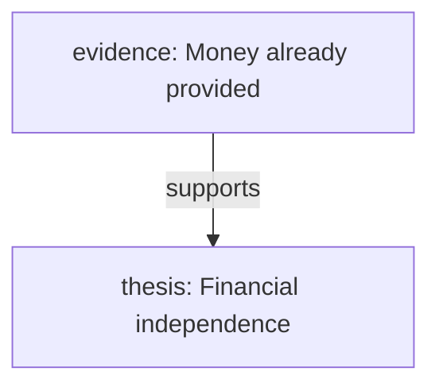

# Gloss Mode C3 — Live Mermaid Graph View qualification

3 November 2026. **C3 implemented and functionally qualified. C4 has not started.** A measurable headless frame-timing cost remains documented below.

## Implementation

Default-on flag: `glossMermaidGraph`, alongside the existing Gloss presentation/relationship flags. Local References now has **References / Graph** tabs. Graph widens the desktop panel and uses the existing narrow drawer, retaining source editors and Cells.

Controls: Selected Gloss / Entire Document, root, depth (default 2), relationship type, TD/LR, node limit (30/60/100), unanchored inclusion (default on), and actual-size scrolling. Selected-root exploration is the default. Edge budget is twice the node budget, capped at 160; depth is capped at 6 and selected traversal at 2,000 distinct inspected relationships. Exhausted budgets show explicit truncation notices. Entire Document omits isolated Glosses; selected mode can show an isolated root.

The diagram is read-only. **Gloss selector → Show in References / Reveal passage** uses canonical identities and C2 navigation. Copy Mermaid exports exact source; the expandable source remains available on renderer/clipboard failure. Controls are transient session state, with no new Blocks, persistence fields, shortcuts or automatic saves.

`glossGraphToMermaid()` reads the C1 graph. Canonical IDs map deterministically to safe `G0…Gn` tokens; labels are never identities. Discovery follows incoming/outgoing adjacency but arrows preserve canonical direction. Cycles, shared nodes and differently typed parallel edges survive. Unresolved/deleted/ambiguous/unsupported/outside-copy endpoints are omitted; C1's Document-wide diagnostic count remains visible. Thesis, evidence and counterarguments receive modest colours; other types remain neutral.

Labels are capped at 64 code points (predicates 36), syntax-sensitive characters are encoded, and unusually expanded source gets shorter labels to remain within the existing 20,000-character guard. Example topology, with styling omitted:

Selected mode observes relevant C1 node/adjacency signals. Whole-Document mode observes a narrow C1 graph revision published for Gloss/relationship changes, never ordinary typing/rebasing. Graph work stops when hidden, its drawer is closed, the Document is invisible, or Gloss Mode is off. Relevant bursts coalesce for 60 ms; obsolete renders cancel. Unchanged source retains its renderer even if diagnostics change.

## Narrow integration corrections and files

Reused the local Mermaid 12.2 bundle, strict source guard, opaque sandbox, SVG sanitiser, cancellation and eight-second timeout. No new graph store or layout engine.

Mermaid's non-HTML SVG labels sometimes displayed numeric entities literally. The Gloss caller opts into decoding them **once into existing SVG Text nodes**, including wrapped tspans, after sanitisation. Decoded strings are never parsed as HTML. Existing structured previews retain their defaults. Optional natural sizing uses the validated SVG viewBox and native iframe scrolling.

Document transfer formerly rejected every iframe. Only the exact opaque frame registered by this Gloss view now qualifies, through a WeakSet; copied markup cannot qualify a frame. Other embedded surfaces remain blocked. Host changes regenerate the disposable diagram while retaining the editor and Graph controls.

Main changes:

- `src/features/gloss/{mermaid.ts,graph-view.tsx,graph-view.css,graph-frame.ts,presentation.tsx,relationship-index.ts}` and `src/configuration.ts`.
- `src/structured/{mermaid-view.ts,mermaid-frame.ts,numeric-svg-labels.ts}` and the narrow guard in `src/application/document-host-transfers.ts`.
- Focused tests, `src/application/gloss-stage-c3.browser-fixture.tsx`, and extensions to the existing qualification/typing runners.

## Tests, browser checks and security

**117 distinct automated tests passed** across Gloss A/B/C1/C2/C3, structured rendering and Document transfer/detachment. The combined run passed 116; the final Graph suite passed 8/8, including one additional bounded-work test with orphan exclusion enabled. Reactive TypeScript checking, structured-asset building and `git diff --check` passed.

Trusted Chrome mouse/key/clipboard interaction passed on native fixtures with **10, 50, 100 and dense 100 Glosses**, containing 9, 49, 99 and 399 active relationships. These use real C1 indexes and retained Flint editors in disposable Caverns; no user vault was modified.

Covered: tabs, root/filter/direction, whole-Document limits, empty/unanchored states, actual-size rendering, exact clipboard export, C2 authoring while hidden, visible relationship/label changes, source navigation, mode transitions, detach/return, narrow drawers and renderer failure/retry. Automated checks additionally cover reversal, retargeting, deletion/restoration, stale completion, cycles/shared nodes, Unicode, adversarial text, budgets and ordering.

Viewing preserved canonical revision/dirty state and recoverable source selection. Mount and Cell identity survived switching and transfer. Graph interaction/local-edit probes recorded **0 snapshots, 0 projection builds, 0 unrelated Document projection writes and 0 API requests**. Only the local renderer asset was fetched and cached. Typing/rebasing performed **0 C1 graph work and 0 Mermaid generations/renders**, including with orphan exclusion enabled.

Actual SVGs were inspected through CDP's isolated frame target, without granting application access. Complete HTML/script payloads, attempted directives, quotes and reserved words remained text: no unsafe SVG elements, event attributes or execution in frame/parent. The frame retains `sandbox="allow-scripts"` without same-origin access and the existing restrictive CSP. There are no SVG click directives or navigation message bridge; arbitrary parent messages do not navigate or redraw.

## Browser measurements

Milliseconds, finite serial Chrome passes—not statistical scaling estimates. Readiness means the sandbox installed its sanitised SVG and acknowledged completion. Interaction includes trusted input, coalescing and polling. Renderer time is elapsed readiness, not isolated CPU. Screenshot/protocol time begins afterwards and is excluded; no arbitrary two-frame settling metric is presented as render latency.

| Fixture Glosses | Rendered nodes / edges | Source | Renderer ready | Interaction → ready | Later screenshot/protocol |
|---|---:|---:|---:|---:|---:|
| 10 | 10 / 9 | 0.1 | 539 | 629 | 323 |
| 50 | 50 / 49 | 1.3 | 1503 | 1611 | 960 |
| 100 | 100 / 99 | 1.1 | 1066 | 1145 | 200 |
| 100-dense | 43 / 160 | 1.3 | 1467 | 1552 | 216 |

| Fixture | First Graph activation | Relationship filter | Root change | Visible relationship update |
|---|---:|---:|---:|---:|
| 10 | 680 | 624 | 622 | 621 |
| 50 | 2177 | 1681 | 1481 | 697 |
| 100 | 1018 | 1048 | 780 | 623 |
| 100-dense | 1026 | 1128 | 1013 | 984 |

The full 100-node measurement raises the default 60-node budget to 100. Dense output truncates at 160 edges and 43 participating nodes. The slower 50-Gloss pass illustrates environmental variation. Converter samples were generally fractions of a millisecond to a few milliseconds, with an observed maximum of 10 ms.

### Real Flint typing

Same 100-Gloss/99-paragraph Document, 1,001 Explorer rows, two pairs with order reversed for the repeat. Each run timed 40 `beforeinput` edit/delete samples in the actual Flint mount and separately passed trusted Chrome character input plus Undo.

| Condition | Synchronous median, runs 1 / 2 | Synchronous p95, runs 1 / 2 | Headless next-frame median, runs 1 / 2 |
|---|---:|---:|---:|
| C3 off, References | 3.4 / 3.2 ms | 12.6 / 8.1 ms | 26.0 / 25.7 ms |
| C3 on, Graph visible | 3.6 / 3.9 ms | 8.9 / 13.0 ms | 43.0 / 46.6 ms |

All four runs recorded zero graph work, diagram generation/rendering, snapshots, service requests and worker starts. Status reads were 40, independent of Explorer row count. **The visible diagram has a measurable headless frame-interval cost despite zero derived graph work during typing.** CSS containment did not remove it and was not retained. These intervals are not keypress-to-pixel latency; neither performance parity nor a specific compositor cause is claimed. This remains a qualification limitation, without expanding C3 into a rendering-engine refactor.

## Screenshots and artifacts

Real 10-Gloss fixture rendered through the existing sandbox:

Selected-root exploration with a relationship filter:

Dense overview with an explicit truncation notice; use selected scope/filtering or actual-size scrolling to read labels:

[Narrow drawer/security-label screenshot](artifacts/gloss-stage-c3-10/narrow-graph.png) shows hostile markup displayed as text alongside the retained source editor.

Raw results: [10](artifacts/gloss-stage-c3-10/qualification.json), [50](artifacts/gloss-stage-c3-50/qualification.json), [100](artifacts/gloss-stage-c3-100/qualification.json), [dense 100](artifacts/gloss-stage-c3-100-dense/qualification.json). Typing measurements/profiles: `artifacts/gloss-stage-c3-typing-{before,graph,before-repeat,graph-repeat}/`.

Reproduce with `npm run build:structured-assets`, then `GLOSS_STAGE=c3 GLOSS_GRAPH_SIZE=100 node scripts/qualify-gloss-browser.mjs`; add `GLOSS_GRAPH_DENSE=1` for dense. The typing runner accepts `BENCHMARK_GLOSS_MERMAID=false` for baseline, or `BENCHMARK_GLOSS_GRAPH=1` together with `BENCHMARK_GLOSS_PRESENTATION=1` for visible Graph.

## Remaining limits / stopping point

SVG nodes are read-only; navigation uses the matching selector. Dense fit-to-width output is an overview, not a readable substitute for selected-root exploration. Diagram regeneration takes roughly 0.5–2 seconds in these passes. Escaped-label wrapping still follows Mermaid's layout. Controls persist within the retained session, not across application reloads. The measured headless frame cost remains open.

C3 is complete for review. **No C4 Argument Explorer work, canonical transaction refactor, graph database, new persistence model or automatic save was introduced.**
