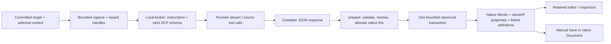

# Dialectic — native AI authoring investigation

7 November 2026. Read-only source investigation following live OpenAI testing. No application, schema, database or runtime changes; no provider requests or new test runs. Existing test implementations were inspected. The particular live exchange was not captured for this investigation, so causes of that response are distinguished from confirmed code behaviour.

## Finding

**DCP already materialises native structures. The integration does not reduce successful model output to undifferentiated prose. However, context delivery, authoring instructions, semantic discovery and visible feedback are incomplete. Some requested operations are also absent.** Plain paragraphs with empty semantic arrays satisfy the current contract, even when the user's intention calls for addressing or annotations. Validation checks structural correctness, not fulfilment of that intention.

The smallest useful correction is to expose and explain the existing authoring capabilities coherently, then add narrowly scoped revision/addressing operations only where the existing contract cannot express the requested action. Another editor, content store or AI graph is unnecessary.

## 1. What reaches the model

[`controller.ts`](../../src/features/dialectic/controller.ts), `capture()` and `askDcp()` (lines 131–233), builds each exchange from **one primary target plus explicitly selected context**. Ask does not submit the draft; Submit & Ask commits it first. The whole chronological conversation is not automatically supplied.

Initial context items have only this shape:

```json
{"handle":"source-<exchange-local UUID>","plainTextExcerpt":"Descendant text joined with newlines"}
```

The selected composition is flattened here: child identities, table structure, participant names/IDs, chronology, timestamps, annotations and relationships are absent. Capture is bounded to 6,000 characters and 512 visited Blocks. Durable targets/revisions are recorded locally in the consumed-context manifest, but that richer manifest is **not** what the model initially receives.

[`DcpSources.source()`](../../src/features/dialectic/dcp/sources.ts), lines 50–87, can subsequently supply:

| Information | Available through retrieval |
| --- | --- |
| Native identity | Owner-qualified `target`, including stable Block GUID where applicable; an opaque handle stable only within this exchange |
| Structure | Native Block type and up to 64 child handles; further reads needed for descendants |
| Text/version | Current text and an exchange-local revision token; historical text for ranges/arguments |
| Authorship | Coarse `human`/`ai`/`mock` source author; **not** participant identity/name, contribution ordinal or timestamp |
| Annotations | Up to 128 property IDs, types, offsets, deletion state and selected AI provenance; Entity handles where supported |
| Semantic definitions | Arguments, their anchor and incident relations, Entities, or relations **if a corresponding handle is already available** |

Important discovery gap: reading a contribution does not export its reply edges, `discursiveReferences` or semantic identity map. Ordinary text annotation results omit `annotationId`, so anchor/Gloss/argument identities are not generally discoverable from those properties. Text search does not provide a semantic-definition inventory. Selecting an argument explicitly works, but finding that argument from its contribution is poorly connected.

There are two retrieval tools: `read_source(handle)` and case-sensitive substring `search_symposium(query, limit)`. Together they have six calls per exchange; search has aggregate traversal/character limits. This can make several nested source targets expensive to discover. Each Ask starts a new provider conversation; prior turns survive only through native context selection/retrieval, not provider-hosted memory.

## 2. Instructions and addressing

[`exchange.ts`](../../src/features/dialectic/dcp/exchange.ts), lines 11 and 31, supplies a short Protocol Key, capability legend and budgets. With `scopedSemantics` enabled—the default—the runtime uses profile `4b-1`, with the live Protocol Key version suffix `-c1`. It does **not** retain the Stage 4A prohibition on semantic authoring.

[`providers.ts`](../../server/dialectic/providers.ts), `conversation()` and `providerTurn()`, sends that key as OpenAI instructions, the entire request as one JSON user message, strict response/tool schemas, and brief additional guidance. The schema describes field shapes, but supplies virtually no operational explanations. The repository's [DCP examples](DCP_V1_EXAMPLES.json) and explanatory [schema proposal](DCP_V1_RESPONSE_SCHEMA_PROPOSAL.json) are not included in these instructions.

Consequently, the model is not adequately taught:

- How issued source handles differ from durable native IDs and response-local aliases; guessed GUIDs are rejected.
- To read a contribution's children before anchoring text, use the returned revision, and disambiguate an exact quote with prefix/suffix.
- The restricted `<annotation type="…" id="…">…</annotation>` and `<boundary id="…"/>` grammar. `markup` is a string in the schema, not a grammar definition.
- That response `replyTargets` become **additional contribution-level discursive references**, while the host-selected primary reply is fixed.
- How new anchors, arguments and directed relations depend on one another, or which existing semantic objects can be reused.

There is also a task/instruction ambiguity: the current user contribution appears inside `plainTextExcerpt`, while both the Protocol Key and provider instructions designate source text as data and prohibit following instructions embedded in it. There is no separate explicit task for this Ask. This protects against instructions in retrieved material, but does not clearly distinguish the participant's current request from quoted context. It is a plausible contributor to under-use of structure, not a proven explanation of the observed exchange.

## 3. Complete materialisation path



[`broker.ts`](../../server/dialectic/broker.ts) retains provider conversation state only for the exchange. [`live.ts`](../../src/features/dialectic/dcp/live.ts) executes returned source calls through the existing Document-scoped source service. Streaming JSON is transient preview text; incomplete output never becomes authored content.

[`prepare()`](../../src/features/dialectic/dcp/exchange.ts) parses the complete JSON, validates envelope/fields, capabilities, unique aliases, budgets, ownership, endpoint types and source freshness. Exact selectors resolve through canonical text/Cell boundary mapping; missing, ambiguous, stale or Cell-splitting selections fail. It allocates ordinary native Block GUIDs, standoff properties and linked definitions. [`semantics.ts`](../../src/features/dialectic/dcp/semantics.ts) keeps passage anchors, classifications, arguments, Entities and Glosses separate.

The controller atomically merges definitions into the Document's `linkedAnnotations`, appends properties to affected source Blocks and inserts the new contribution before the draft. Existing bounded canonical transactions provide Undo/Redo and dirty tracking; manual Save persists the native Document. Request, retrieval trail, raw DCP response, semantic alias mapping and provider provenance accompany the contribution. Tool-supplied material is in the DCP trail; the simpler consumed-context manifest describes the initial capture.

**Repair can conceal a failed structural attempt.** One enabled repair is available, but the provider receives a generic instruction to prefer plain paragraphs and empty semantic arrays—not the actual validation error. A structured first attempt can therefore become valid prose on repair. The rejected response/error is retained in provider-attempt provenance, so the exchange record can distinguish this from an initially prose-only response.

## 4. Implemented capabilities and boundaries

| Requested capability | Actual current support |
| --- | --- |
| New compositions | Nested paragraphs, groups, bullet/ordered lists and rectangular tables become native Blocks. Not every Mutable Block family is exposed through DCP. |
| Address earlier contributions/Blocks | Issued handles accepted in `replyTargets`; up to 12 additional references on the **new contribution**. Primary reply remains host-selected. |
| Address several source passages | Up to 32 exact anchors across eligible same-Document TextBlocks, plus references/annotations. Each anchor originates in one complete plain TextBlock; no inline-object selector support. |
| Generated-text annotations | Registered AI-authorable styles/classifications, Entity references and explicit boundary-based overlapping spans. Unknown permitted type names are retained inertly. |
| Existing-text annotations | Append classifications (`claim`, `question`, `speculation`, `suggestion`, `objection`, `qualification`), scoped Entity references, and independent explicit Glosses. Classifications require a newly proposed exact source anchor; they cannot simply target an issued range handle. Existing-text style edits are not admitted here. |
| Argument identity/relationships | Document-owned arguments linked to anchors; directed `supports`, `challenges`, `qualifies`, `contradicts`, `elaborates`, `answers`, `depends-on`, `provides-evidence-for` relations between arguments. No Gloss dependency. |
| Entities | New Document-scoped Entities and relations; use of issued existing local/vault Entity references. No global Entity mutation. |
| Revise an existing interpretation | **No update, remove or replace operation.** Another annotation or qualifying argument can be added, but does not revise the old record. |
| Relationships between contribution containers | Primary replies/additional references exist. Typed argument relations cannot use contribution/Block endpoints directly. They require explicitly authored arguments on passages. |
| Bind each generated response Block to its own targets | **No per-node addressing field.** Composition IDs are checked for uniqueness but are not added to the persisted alias map; that map covers semantic identities. |
| Change existing content/layout | No AI edit/delete/reorder command. DCP adds a contribution and permitted source annotations. |
| Other deferred operations | Sequence authoring/choreography, multimodal assets, cross-Document retrieval/authoring, promotion and continuation suggestions are not enabled by this response profile. |

## 5. What is visible

[`view.tsx`](../../src/features/dialectic/view.tsx), lines 70–87, exposes Reply sources, Discursive references, Semantic identities, directed argument relations and the complete DCP exchange record. The chronology shows primary replies only. Native generated layouts/styles render through the retained editor.

However, [`registerDcpTypes()`](../../src/features/dialectic/dcp/markup.ts) registers the six classifications with `renderers: []`; range anchors are likewise invisible registrations. They do not automatically paint a visible classification highlight or badge. Inspecting a range/argument uses the existing temporary SVG range-decoration collection, but there is no dedicated classification/provenance presentation in the conversation view. Absence of visible annotation is therefore **not evidence that no property was authored**.

The exchange record provides a bounded diagnostic: inspect `response`, `tools`, `identityMap` and `provider.attempts[].rejectedResponse/repair`. This distinguishes no retrieval, empty semantic output, repair simplification and successful but inconspicuous materialisation. Existing tests exercise native source annotations, identities, directed relations, persistence and Undo; scripted fixtures do not establish that an uninstructed live model will choose those operations.

## 6. Smallest coherent next implementation

1. **Make context structurally usable.** Export a bounded selected-source manifest using existing references: handle, typed native identity, contribution participant/ordinal/time, child structure, revision and relevant semantic handles. Preserve explicit context selection; retrieve additional sources on demand. Do not transmit the entire conversation or invent persistent AI IDs.
2. **Complete the executable instructions.** Clearly identify the participant's current task while retaining retrieved content as untrusted data. Document handle/alias rules, exact anchoring, markup grammar, dependency order and direction; include compact valid examples for multi-source addressing and a native relationship. Explicit requests for supported structures should produce those structures. Ordinary conversation must remain valid without semantic markup.
3. **Preserve structural intent during repair.** Return bounded, sanitised validation codes/paths and instruct repair of the specific invalid operation. Keep the existing single-repair limit and atomic commit; do not silently recommend discarding all semantic content.
4. **Expose successful authoring.** Add a compact summary/navigation for addressed Blocks and source classifications, including AI/exchange attribution. Reuse the existing inspector and temporary SVG range decorations. No parallel annotation renderer or graph is needed.
5. **Approve only the genuinely missing operations.** If “revise” means changing a previous classification, add a narrow revision-fenced replacement operation for an explicitly identified annotation, with author/provenance checks and existing canonical Undo. If each generated Block needs its own targets, preserve its local-to-native mapping and attach existing typed references at that level. Generic typed contribution relationships need an explicit semantic decision: use existing reply/reference links for addressing, and argument relations only when an argument is intended. Do not coerce all communication into arguments or introduce a general graph to fill this gap.

Qualification should cover one live multi-Block targeting request, one exact source annotation and directed relationship, and visibility/navigation plus Save/reload/Undo. If revision or per-Block addressing is approved, add one focused case for each. Reuse existing ownership, stale-source, bounded-work and editor-identity regressions; put manifest/retrieval work on explicit exchanges, never ordinary typing. Full definition-map copying remains the already accepted semantic-commit limitation, not a reason for broader refactoring.

**Recommendation:** implement items 1–4 together as the smallest useful completion of native AI authoring, with item 5 explicitly scoped before implementation. Preserve the existing DCP validator/materialiser and independent Desktop/Textual presentations. No implementation has begun.
