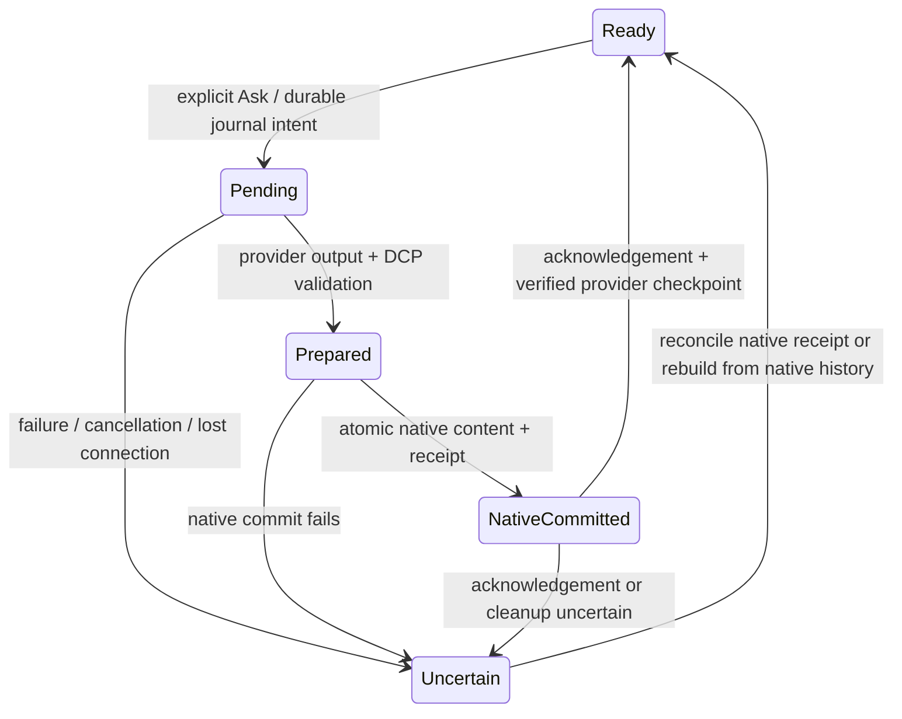

# Dialectic — persistent OpenAI conversations

8 November 2026. Approved implementation completed, including the reusable native text-protection refinement. See [implementation qualification](DIALECTIC_PERSISTENT_CONVERSATIONS_QUALIFICATION.md). The architectural investigation below is retained for context.

## Recommendation

Use OpenAI Conversations as durable provider memory, scoped by **native Cavern/Document identity, AI participant and provider connection**. The Document is the conversation: addresses, multiple topics and reply ancestry do not divide provider memory. Keep native content, identities, annotations, history and manual Save authoritative. Add a small durable broker journal and native commit acknowledgement so uncertain provider state is never silently reused. Put this substantial feature behind `dialecticProviderContinuity`, enabled by default; preserve the existing stateless path when disabled and for Anthropic initially.

This is more than adding `conversation` to the request: the provider commits history before Mutable commits content, and the existing adapter resends accumulated round history. Both boundaries need explicit treatment.

## Existing implementation

| Boundary | Current behaviour |
| --- | --- |
| `controller.ts: askDcp` | Captures current target and explicit context; builds fresh source handles and manifest; validates then performs one bounded native transaction |
| `dcp/live.ts` | Creates a broker exchange for every Ask; handles tools and one validation repair; deletes broker exchange in `finally`, before native materialisation |
| `server/dialectic/broker.ts` | In-memory credentials and per-exchange state only; no durable conversation association or native commit acknowledgement |
| `server/dialectic/providers.ts` | Responses API with `store:false`; neither `conversation` nor `previous_response_id`; accumulates input/output only within one Ask |
| `model.ts`, native persistence | Stable participant IDs and native exchange provenance already persist; no continuity checkpoint |
| Submit/editor | Submitted containers remain editable in the accepted implementation; this differs from the new immutability requirement |

The [actual saved exchange diagnosis](DIALECTIC_NATIVE_AI_ACTUAL_EXCHANGE_DIAGNOSIS.md) confirms that explicit context was empty and only the current request was initially supplied. Search recovered the earlier passage and its annotation was committed. The missing relationship was model omission, not lost provider memory or failed persistence. Continuity must not be presented as a cure for that separate defect.

## Confirmed OpenAI contract

- Conversations have durable IDs and can be retrieved across sessions. Creation accepts initial items; the items API supports append, retrieval, pagination and deletion. Append batches are limited to 20 items. No conversation fork operation is documented in this resource. [Conversation state](https://developers.openai.com/api/docs/guides/conversation-state), [Conversations reference](https://developers.openai.com/api/reference/resources/conversations), [Create items](https://developers.openai.com/api/reference/resources/conversations/subresources/items/methods/create).
- Responses accepts a conversation ID, prepends its history and **automatically adds input/output items after completion**. It cannot combine `conversation` with `previous_response_id`. `truncation:disabled` fails when context exceeds the model window; `auto` drops oldest items. [Responses creation](https://developers.openai.com/api/reference/python/resources/responses/methods/create).
- Conversation data persists until deletion and is not eligible for Zero Data Retention. Deleting the conversation object does **not** delete its items; cleanup must account for items separately. The settings copy must distinguish forgetting local credentials from deleting provider memory. [Data controls](https://developers.openai.com/api/docs/guides/your-data), [Delete conversation](https://developers.openai.com/api/reference/resources/conversations/methods/delete).

API history avoids repeated client uploads; it does not create unlimited model context or make historical input tokens free. Keep usage reporting. No provider transaction/rollback or exactly-once append guarantee is assumed.

## Scope, storage and conversation membership

**Association:** use `(Cavern identity, Document resourceId, participant.id, connectionProfileId, provider)`. There is no branch/context identifier. The connection profile is an opaque local identity, not a credential or a key stored in a Document. Different participant IDs never share a conversation object. Changing models within the same connection need not change participant identity or conversation. A changed provider/account connection uses a separate binding.

Persist a small provider-neutral binding descriptor and accepted checkpoint in Document metadata, together with each exchange receipt. OpenAI-specific IDs live in adapter details, not the core contribution grammar. The selected participant must be explicit in the controller request; use the existing default AI for ordinary single-participant Documents, with a minimal selector if several existing AI participants are available. Do not implement a participant-management suite.

The broker additionally stores **coordination metadata only** under the active Cavern: binding/generation IDs, expected native head/digest, provider item/response IDs, exchange ID and phase. Reuse the pinned-directory/atomic publication helper used by `server/application-services/job-storage.ts`, not its job framework. No secret, duplicate text store, background Document save or repository snapshot. Validate Cavern generation on these requests: the current provider route precedes Cavern middleware and needs a narrow binding check. Settings should explain that Ask now supplies preceding conversation content and that the provider retains it; IDs remain in diagnostics.

**Membership:** synchronise committed native contributions in chronological order, including other participants' contributions. Replying to an early contribution, annotating an old passage or discussing multiple topics keeps the same provider conversation. Do not reconstruct history from reply ancestry. No branch selection, branch records, branch seeding or isolation UI is implemented. Deliberate isolation is a future capability, not a reserved field or new abstraction in this increment. Recovery creates another provider-memory generation for the same Document conversation.

For initial seeding and recovery, project native contributions into bounded chronological provider items with author, time, native IDs and nested composition structure. Other participants' public native contributions can be included, but their private provider/tool histories are not copied. Preserve text, standoff meaning and supported layouts as data; unsupported media is explicitly identified. This is a disposable provider projection, not another editable content model. Provisionally use the approved replay safeguards: 128 contributions / 128,000 text characters / 1 MiB encoded data, paged in batches of at most 20 items. Exceeding them pauses with a coverage explanation; never silently omit earlier turns. Incremental normal turns transmit only the unsynchronised delta.

## Synchronisation and failure handling

1. **Begin:** fence one in-flight exchange per binding across browser sessions; compare its expected native checkpoint. Persist the journal intent before remote mutation. Submit alone remains local. On explicit Ask, bring in preceding unsynchronised committed contributions and keep the current participant request separately designated; do not send it twice.
2. **Generate:** attach the conversation ID to Responses. Send only newly required inputs/tool results each round; do not replay `state.input` or output already stored by OpenAI. Keep fresh DCP instructions/schema on every request. Record response IDs as soon as available and bound item reconciliation to the current exchange suffix.
3. **Validate:** preserve existing validation and single repair. Provider output is provisional while native admission is pending. If repair succeeds, remove rejected response/repair-only items before declaring history clean; if that cleanup cannot be proven complete, quarantine the binding. Never treat an invalid candidate as a committed AI turn.
4. **Commit:** insert native content/annotations/relationships and the continuity receipt in the same existing bounded transaction. Only then acknowledge the broker. Its prepared record must outlive the transport; the current unconditional exchange deletion cannot serve as commit acknowledgement. Provider metadata does not add a second content-history operation.
5. **Recover:** failed validation/materialisation, cancellation, timeout or uncertain remote append leaves an observable pending/uncertain binding. Do not blindly retry Responses or append the same inputs. A matching native receipt completes acknowledgement without generating again. Otherwise create a fresh provider conversation from authoritative native history on the next explicit Ask; never reuse a possibly contaminated conversation. Retain bounded cleanup information for abandoned remote objects rather than claiming they were erased.

Use a stable native exchange ID plus expected head for retry deduplication. A repeated request returns the known status/receipt or a conflict, not another model call. Local abort does not prove remote rollback. Limit reconciliation to known IDs and a bounded suffix; unexpected items or concurrent writers cause isolation/rebuild, not deletion of unknown data.

**Reload and Undo:** saved native checkpoints reconcile with the durable journal. If the browser lost unsaved content, or Undo removed an AI contribution, provider memory must not resurrect it: use the restored native head and a fresh provider generation. The association can survive reload, but unsaved native content is still subject to manual-Save semantics. Document copies with new identities clear provider bindings; Save As retaining the same native identity is handled by the checkpoint fence. Two divergent open copies must not both advance one remote conversation.

Missing conversations can be rebuilt from native history with an explicit recovery notice. Authentication/access failures pause for configuration; do not repeatedly create replacement objects. Credential expiry/Forget keys does not delete memory. Automatic reuse never crosses participant or connection boundaries.

## DCP, context limits and immutable contributions

Maintain four distinct inputs: **provider memory, current request, fresh structural manifest, current retrieval results**. Historical handles in provider memory are expired capabilities; only handles issued by the current `DcpSources` instance can author anything. Keep native source fencing and exact selectors unchanged. Put reusable instructions/examples in current provider instructions instead of repeatedly persisting them inside historical request data where practical; memory remains data, not fresh instructions.

Use explicit `truncation:disabled` initially, preserving the current model choice. Record usage; on context exhaustion, stop with a clear explanation. Automatic summarisation/compaction is deferred because it changes what “remembers” promises. This boundary does not prevent the required ten-plus-contribution case. Do not silently fall back to a stateless response or a recent-turn-only window.

The brief supersedes the earlier editable-contribution behaviour. A real implementation must prevent text/composition rewriting after Submit while allowing annotations on existing passages. Existing passive Sequence policy blocks annotation commands too and covers only selected Block families, so it is not a drop-in lock. The application-boundary qualification found no complete pre-mutation hook with the required target/operation information: direct TreeCommands, cross-Block edits and Scry completion can bypass the controller and command registry. The current repository before-snapshot observer captures snapshots; the cheaper before-change observer exposes only a label/cause, not the proposed writes. Neither can enforce this rule reliably.

**Approval required before proceeding:** add a narrowly scoped pre-commit guard receiving the existing operation batch, with Dialectic-specific ownership/content checks outside the generic repository, and a small native input integration so rejected typing does not leave provisional DOM changes. Drafts, ordinary Documents and annotation-only operations retain existing behaviour. See the qualification for concrete boundaries, alternatives and focused regression criteria. No monkey-patching, replacement editor or after-the-fact rollback. Unexpected historical mutations from imports must invalidate continuity before another Ask.

## Implementation slices and affected modules

| Slice | Minimal work and files |
| --- | --- |
| 1. Native continuity identity | `model.ts`, `controller.ts`, small `continuity.ts`, `provider-contract.ts`, configuration flag; participant/connection/checkpoint derivation; scoped immutable-content admission only after its required approval, and existing copy-path binding reset |
| 2. OpenAI lifecycle | New `server/dialectic/conversations.ts` and small journal adapter; `broker.ts`, `providers.ts`, `server/index.ts`; create/retrieve/append, delta-only continuations, fencing, prepared/ack/recovery |
| 3. Integration and qualification | `dcp/live.ts`, `provider-settings.tsx`, existing inspector in `view.tsx`; reconnect/recovery notices, opaque diagnostics, focused existing tests/browser runner |

Native serializers, existing source resolvers and canonical materialisation remain authoritative. No new editor, application runtime, general graph or branching framework. Typing does not synchronise memory, scan history, write the journal or call a provider. Bootstrap/recovery runs only on explicit Ask; normal work follows new contributions and the small checkpoint. No implementation or new provider requests were performed during this investigation.

## Focused qualification

- Existing provider/broker fixtures: create/retrieve/reuse ID; incremental inputs including tools without duplication; separate participant/profile bindings; cancellation, validation failure, native failure, lost acknowledgement and retry deduplication; missing-conversation recovery and context-limit errors.
- Controller/native tests: binding persists through Save/reload; Undo/copy invalidate correctly; draft typing is local; committed text is protected but source annotations remain admitted; no snapshots/unrelated Document work during ordinary typing or exchange commit.
- One trusted browser scenario: at least **12 ordinary contributions**, ask about an early distinctive fact with **no selected context**, Save/reload/continue, then address and annotate an early TextBlock with current handles and inspect a correctly directed relationship. Assert that early-target addressing retains the same provider conversation, and check intended argument endpoints, not only counts.
- One small live OpenAI scenario covering that continuity/reload/retrieval path, using synthetic content and the existing server credential. No user conversation is submitted as a test fixture. Report provider IDs in diagnostics only, usage, native outcomes and failure-state evidence. No broad suite or alternate model campaign.

## Approval boundary and next action

The revised provider scope, coordination journal, native acknowledgement, recovery and provisional replay limits are approved. The shared-editor immutability integration described in [the original boundary inspection](DIALECTIC_COMMITTED_IMMUTABILITY_QUALIFICATION.md) was subsequently approved and implemented as reusable native text protection. See the implementation qualification above. The actual-exchange authoring/visibility corrections remain separate; no unrelated semantic fixes are included.
