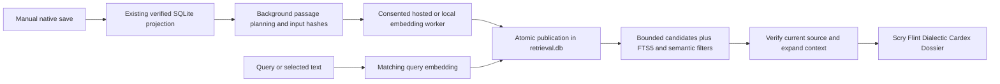

# Native Vector Search and RAG Investigation

**Current status — 14 November 2026:** Milestones A–C have been accepted. Milestone C is formally closed; see the [final acceptance record](NATIVE_VECTOR_SEARCH_RAG_MILESTONE_C_FINAL_ACCEPTANCE.md). Its remaining limitations are non-blocking future improvement opportunities. No further development, testing or paid calls will be initiated for this milestone. The investigation and proposed sequence below are retained as historical design context; optional extensions require separate authorisation.

14 November 2026 · Investigation and measurements begun 13 November · Investigation only · Implementation requires review

Mutable can add useful semantic retrieval without changing `.ink`, replacing SQLite, or involving a generative model in ordinary search. Start with **sqlite-vec 0.1.9 exact search**, ordinary passage metadata, and a separately configured embedding provider. Use **structure-aware passages**, combine vector results with existing lexical and semantic retrieval, and keep indexing outside editing and save completion.

Recommend a **disposable `.mutable/retrieval.db` per Vault**, owned by the existing host lifecycle. This remains SQLite infrastructure, but avoids making optional vector extensions and dynamic model tables prerequisites for opening the authoritative `mutable.db`. This placement is a proposal, not an implemented change.

Both sqlite-vec and SQLite Vec1 loaded successfully against the installed driver. A small synthetic probe supports starting with exact search; it does not establish semantic relevance or production latency. No embedding APIs were called, model weights downloaded, application code changed, or user Documents/databases modified.

## 1. Verified persistence and authority

### Current representation

| Data | Current representation and authority |
|---|---|
| Saved Document | Native `.ink` content is authoritative for authored Document structure, text, Document-scoped definitions and annotations. The editor's canonical repository is authoritative for current unsaved edits. |
| Saved Resource | Derived `Resource` row: stable GUID, path, root Block, file hash, optional save-generation identifier, extraction profile and coverage status. |
| Block | Derived `Block`: integer SQL key, unique native `guid`, owning Resource, native/authored type, text, coordinate system, Cell count and serialized authored attributes. |
| Structure | `BlockRelation`: child order, named owned relations, placement identity, external target descriptors and ownership kind. `BlockProperty` retains normalized columns and serialized properties. |
| Text | Standoff Cells are assembled into `Block.text`. `BlockTextRun` stores eligible contiguous text runs and UTF-16-to-Cell boundary maps; `BlockSearch` is the associated FTS5 index. Inline objects split searchable runs. |
| Annotations | `StandoffProperty` stores ranges, coordinate system, type, values, resolved definition ownership, excerpt and authored attributes. `AnnotationDefinition` stores linked definitions and their owning Block. SQL range ends are exclusive; native standoff ends are generally inclusive. |
| Vault knowledge | `Entity`, `EntityAlias`, `Relationship`, `Claim`, `ClaimParticipant`, `ClaimQualifier`, `ClaimEvidence`, `Time`, `DataSet` and related tables contain independently queryable semantic records. Canonical semantic mutations have their own revision and audit/outbox transaction. |
| Dialectic semantics | Document Entities, scoped relationships, Arguments and Glosses are native linked definitions/metadata, projected into `AnnotationDefinition` and standoff/Block records. They are **not automatically equivalent to rows in canonical SQL `Entity` or n-ary `Claim`**. Contribution participant, ordinal, synopsis and reply/reference data are serialized authored Block metadata, not dedicated Contribution tables. |

Sources: [saved projection](../../src/knowledge-sqlite/saved-projection.ts), [foundation schema](../../src/knowledge-sqlite/migrations/mutable/0001-foundation.sql), [semantic schema](../../src/knowledge-sqlite/migrations/mutable/0002-semantic-knowledge.sql), [proposition extension](../../src/knowledge-sqlite/migrations/mutable/0008-propositions.sql), [scoped Entities](../../src/feature-api/scoped-entities.ts), [Arguments](../../src/features/dialectic/arguments.ts), [Gloss model](../../src/features/gloss/model.ts), [Contribution model](../../src/features/dialectic/model.ts).

The saved projector covers all decoded non-Cell native content records, including retained definitions; it is not limited to a small list of renderers. Searchable text is narrower: standoff text, plain/text Blocks and supported Markdown/HTML source Blocks. Opaque applications retain structural information but exclude their text descendants from search. Media does not automatically gain OCR or transcription. External placements retain target references; indexing must not assume their content is locally owned. The current saved projector has a **20 MiB file limit and 100,000-Block limit**; report incomplete coverage rather than silently dropping oversized Documents. [Extraction policy](../../src/knowledge/policy.ts), [canonical text extraction](../../src/runtime/canonical-search-source.ts).

Native Block GUIDs populate `Block.guid`; integer `Block.id` is a database implementation detail. Legacy missing IDs may receive deterministic, explicitly marked projection IDs, without rewriting the Document. They must not be presented as authored native identities. Use Vault + Resource + Block identity in retrieval, and retain occurrence/placement routes when a Block appears more than once. Never use filenames or SQL row IDs as external source authority.

### Corrections to the brief's assumptions

- The SQLite scope is **one established Vault**, shared by its Documents: `<vault>/.mutable/mutable.db` and `audit.db`. A Cavern can encompass distinct Vault contexts. Cavern-wide retrieval must federate authorized Vault scopes; it cannot assume one global database. Overlapping established Vaults are rejected. [Foundation](../../src/knowledge-sqlite/foundation.mjs), [Vault scope](../../src/knowledge-sqlite/vault-scope.mjs).
- **Not all SQLite data is a disposable shadow.** Canonical Vault Entities, Claims and Relationships must survive document-index rebuilds. Only explicitly derived records may be cleared. [Schema and derived reset](../../src/knowledge-sqlite/schema.mjs), [canonical ledger](../../src/knowledge-sqlite/canonical-ledger.mjs).
- Saving is currently manual; `dialecticAutosave` defaults to false. An optional submission-save path exists and yields for paint. Embedding work must depend on neither automatic saving nor that path being enabled. [Configuration](../../src/configuration.ts), [submission save](../../src/features/dialectic/submission-save.ts).
- Native Undo/Redo and file persistence are separate from canonical SQLite semantic transactions. There is no existing transaction spanning an unsaved Document, its filesystem publication, and all semantic SQL mutations. Do not claim cross-store atomicity.
- `sqliteKnowledge:true` does not mean all unopened saved Documents are automatically included in every application's query scope; `nativeKnowledgeSaved` currently defaults to false. Preserve explicit scope/coverage choices.

### Existing update machinery

`repository.resourceGeneration(id)` is a cheap monotonic committed-change indicator, including Undo/Redo. Save captures a generation and only acknowledges those captured contents; concurrent changes remain dirty. Saved SQL uses durable file hashes, save evidence and scope/revision fences. **The live generation is an invalidation signal, not a durable embedding revision or text hash.** Style or loading-notice edits can advance it without changing embedding input.

Saved reconciliation runs in a Vault-owned worker. The host cancels background work for foreground storage and validates source evidence again before publication. Its current incremental mode still performs discovery/inspection; it is not a per-keystroke or per-Block embedding scheduler. Reuse the completed projection rather than initiating another Vault sweep for every embedding job. [Repository generation](../../src/block-tree/repository.ts), [save coordinator](../../src/persistence/resource-pair.ts), [native session](../../src/persistence/native-session.ts), [index host](../../server/sqlite-knowledge-host.ts), [saved indexer](../../server/sqlite-saved-indexer.ts), [worker client](../../src/knowledge-sqlite/client.mjs).

Read-only inspection of `vaults/imported/.mutable/mutable.db` found 2,317 Resources, 9,057 Blocks, 6,132 text-bearing Blocks, 6,138 searchable runs and 1,217,646 text characters. Coverage included two incomplete Resources and one stale Resource. It also contained 15,311 Entities, 4,185 Relationships and 1,972 Claims. These are observed database counts, not a claim that every current Cavern file or unsaved edit is indexed.

## 2. SQLite extension comparison and local qualification

Installed runtime: **Node 22.12.0, better-sqlite3 12.4.1, SQLite 3.50.4, macOS arm64/Apple M1**, with FTS5 and extension loading available.

| Criterion | sqlite-vec, pinned stable 0.1.9 | SQLite Vec1, tested source version 0.8 |
|---|---|---|
| Initial retrieval | Exact KNN using `vec0`; scalar distance functions also support ordinary BLOB tables. | Exact unindexed/flat modes; trained IVFADC/OPQ approximate mode. |
| Dimensions and representations | Fixed dimensions per vector column, up to 8,192 in this release; float32, int8 and bit vectors. | Equal-length finite float32 BLOB vectors; length established by data. No explicit small dimension cap is documented; test chosen dimensions and reject malformed vectors in the host. |
| Metrics | `vec0` L2/cosine, Hamming for bit vectors; L1 also available as a scalar operation. | L2 and cosine. L2 scalar returns squared distance; raw scores are not interchangeable between adapters. |
| Index lifecycle | No training for the proposed exact path. | Flat mode can be rebuilt without ANN training. ANN adds representative training data, trained model, rebuild and recall tuning. |
| SQL relationships | Integer/text identifiers, ordinary joins, supported metadata and partition filtering. | Row IDs join ordinary tables; metadata filters and streaming query mode support filtered retrieval. |
| Packaging | npm package loads into better-sqlite3; stable binaries currently list macOS arm64/x64, Linux arm64/x64 and Windows x64. Other targets need compilation/qualification. | Portable C source; compile/package `.dylib`, `.so` or `.dll`. SIMD build selection matters, especially older x86 CPUs. |
| Browser/WASM | Documented WASM route; requires the extension in the SQLite WASM build, not loading the native `.dylib` in a browser. | Portable C is promising, but WASM SIMD remains on its roadmap. Browser packaging was not qualified here. |
| Maturity/licensing | Pre-1.0; MIT/Apache-2.0. Pin the binary and qualify upgrades. Current website includes alpha documentation; do not mistake development ANN work for the tested stable route. | SQLite-maintained, pre-1.0; source disclaims copyright. Current roadmap still includes optimization/testing and other index types. Pin source/build provenance. |

Primary references: [sqlite-vec repository](https://github.com/asg017/sqlite-vec), [Node integration](https://alexgarcia.xyz/sqlite-vec/js.html), [KNN](https://alexgarcia.xyz/sqlite-vec/features/knn.html), [vec0 metadata](https://alexgarcia.xyz/sqlite-vec/features/vec0.html), [API](https://alexgarcia.xyz/sqlite-vec/api-reference.html), [stable dimension limit](https://raw.githubusercontent.com/asg017/sqlite-vec/v0.1.9/sqlite-vec.c), [WASM](https://alexgarcia.xyz/sqlite-vec/wasm.html), [Vec1 overview](https://www.sqlite.org/vec1.html), [manual](https://www.sqlite.org/vec1doc.html), [reference](https://www.sqlite.org/vec1ref.html), [source/license](https://raw.githubusercontent.com/sqlite/sqlite/master/ext/vec1/vec1.c).

### Measurements performed

Downloaded the pinned sqlite-vec macOS package to a temporary directory; compiled Vec1 against the installed SQLite headers. No package manifest or lockfile changed. Both extensions passed loading, self-neighbour lookup, relational source-ID lookup, transaction rollback and reopening a temporary database.

| Vectors × dimensions | sqlite-vec warm p50 / p95 | Vec1 flat warm p50 / p95 | sqlite-vec / Vec1 DB size |
|---|---:|---:|---:|
| 1,000 × 384 | 0.46 / 2.32 ms | 0.42 / 0.91 ms | 1.65 / 2.10 MB |
| 10,000 × 384 | 4.52 / 4.78 ms | 4.86 / 8.65 ms | 16.19 / 20.74 MB |
| 10,000 × 1,536 | 20.50 / 34.92 ms | 19.70 / 26.83 ms | 63.43 / 82.22 MB |

At 10,000 × 1,536, sqlite-vec insertion took 838 ms; Vec1 insertion plus flat rebuild took 356 + 513 ms. These are synthetic Float32 L2 probes, one insertion transaction, default DELETE journaling, three warmups and twenty timed queries. They exclude embedding generation, RPC, filtering, realistic content distributions, UI and concurrent editing. DB sizes include a small passage table and allocation/free-page effects. They are not an ANN benchmark or a semantic relevance score.

A concrete integration detail: binding JavaScript Numbers as explicit `vec0` row IDs failed in this driver; binding `BigInt` succeeded. Bind true SQL integers, and return opaque string result identifiers at the application boundary. Dimension construction accepted 8,192 and rejected 8,193.

Evidence and reproducible probe: [results](../qualification/vector-search/exact-probe.json), [probe](../qualification/vector-search/exact-probe.mjs). Vec1's downloaded source SHA-256 is recorded in the results.

**Recommendation:** sqlite-vec exact search first because it has a direct packaged route and no training lifecycle. Vec1 is a credible later option, not rejected on performance: the measured exact timings are comparable. Consider ANN only after a realistic larger corpus exceeds the chosen query-latency target and a recall test justifies its extra complexity.

Storage planning, before SQLite metadata/index/WAL overhead: `passages × dimensions × 4` bytes. At 384 dimensions, 10k/100k/1m passages need 15.36 MB/153.6 MB/1.536 GB; at 1,536 dimensions, 61.44 MB/614.4 MB/6.144 GB. Exact scanning grows with corpus size and dimensions. The 100k/1m cases were not measured; do not extrapolate guaranteed latency from the small probe.

## 3. Embedding strategy

Keep embedding configuration and credentials independent of Dialectic's generative provider. A small internal adapter should expose model description plus `embed(inputs, purpose, signal)`, returning vectors, actual dimensions, model provenance and usage. `purpose` distinguishes query and passage preprocessing. Validate count, finite values, dimension, normalization and response ordering. Model interchangeability does **not** mean vectors from different models are compatible.

| Option | Proposed use and constraints |
|---|---|
| OpenAI `text-embedding-3-small` | Hosted baseline after explicit consent. Default 1,536 dimensions; configurable shorter dimensions. Test 1,536 first to avoid confounding chunk quality with dimension reduction; compare 512 only if storage warrants it. |
| Local `BAAI/bge-small-en-v1.5` | English/offline comparison: 384 dimensions, 512-token context. Apply the model's documented query instruction/pooling and normalization consistently. Cache pinned tokenizer/model artifacts; never silently truncate long passages. |
| Local execution | Prefer a Node worker with ONNX Runtime/Transformers.js so the existing browser does not acquire a second persistence/runtime architecture. Browser WASM/WebGPU remains optional future deployment work. |

The OpenAI model currently costs **US$0.02 per million input tokens**. Its API accepts multiple inputs, with 8,192 tokens per input and 300,000 total tokens per request; the host should use much smaller batches. Start with at most 32 passages or 12k tokens per batch and low concurrency. Those batch sizes are proposed application limits. [Model/pricing](https://developers.openai.com/api/docs/models/text-embedding-3-small), [embedding guide](https://developers.openai.com/api/docs/guides/embeddings), [API limits](https://developers.openai.com/api/reference/typescript/resources/embeddings/methods/create).

Estimated standard API charges, counting actual submitted tokens including overlap and repeated profiles:

| Submitted tokens | Cost |
|---:|---:|
| 10,000 | $0.0002 |
| 100,000 | $0.002 |
| 1 million | $0.02 |
| 10 million | $0.20 |

One thousand 50-token query embeddings add $0.001. These are arithmetic estimates, not measured bills or a promise about token counts. Hosted latency remains unmeasured. OpenAI's asynchronous Batch API advertises a 50% discount and up-to-24-hour completion, suitable for optional bulk rebuilds rather than interactive queries. [Batch API](https://developers.openai.com/api/docs/guides/batch).

BGE's published model card reports 384 dimensions, 512-token sequences and an MIT license. The repository lists a 133 MB safetensors weight file; downloading all model variants is unnecessary. A provisional **0.5–1 GB worker RAM budget** for model/runtime/activations is an engineering allowance, not a measurement. CPU throughput, cold start, quantized ONNX equivalence and actual RAM need qualification on the target machine. Offline means no provider request after artifacts are installed. [BGE model card](https://huggingface.co/BAAI/bge-small-en-v1.5), [files](https://huggingface.co/BAAI/bge-small-en-v1.5/tree/main), [Transformers.js](https://huggingface.co/docs/transformers.js/en/index).

Literary allusion, conversational disagreement, source-code symbols and scholarly terminology need different relevance checks. Neither model's general benchmark establishes performance for Mutable. Retain lexical search for exact quotations, names, dates, identifiers and citations. Begin with English fixtures; multilingual retrieval needs a separate model/quality decision.

External indexing requires explicit scope, provider and cost consent before sending Document text or queries. A Dialectic API key is not consent to upload a Vault. Provide local-only mode and a revocable per-Vault policy. OpenAI documents no API training by default and possible abuse-monitoring retention; do not describe hosted embeddings as zero-retention without appropriate account controls. [Data controls](https://developers.openai.com/api/docs/guides/your-data).

Persist model ID, provider, available revision, tokenizer/preprocessing/pooling, dimensions, normalization and profile hash. Pin local files by hash. OpenAI currently lists the model alias itself, not a separately selectable dated embedding snapshot; retain returned model information and an application profile revision rather than inventing a version guarantee. A model/profile change builds a separate index and switches atomically when ready. Never silently query old vectors with a new model.

## 4. Derived SQLite storage and source references

`schema.mjs` hashes the entire `sqlite_schema` against its migration-defined structure. Dynamically creating model-specific virtual tables in `mutable.db` would fail validation; extension upgrades can also change shadow-table structure. Do not relax this validator.

**Recommended physical location:** `<vault>/.mutable/retrieval.db`, with the verified Vault GUID, explicit schema/profile version, allowlisted extension binary and existing host lease/close discipline. Missing or incompatible retrieval data disables semantic search, not native Document/Entity access. Backups may omit this rebuildable database or include it as an explicitly derived artifact. A valid alternative is a migration-defined fixed vector table in `mutable.db`, but it tightly couples model dimensions and extension availability to authoritative database opening; it is less suitable for multiple optional profiles.

Proposed logical schema:

| Record | Minimum fields |
|---|---|
| `RetrievalProfile` | Profile ID/hash; embedding provider/model/revision; dimensions, metric, dtype; tokenizer/preprocessing; chunker/extraction version; extension version; ready/building state. |
| `RetrievalDocument` | Profile + Vault/Resource identity; source file hash/save generation; metadata hash; indexed revision; queued/running/ready/stale/error status and bounded error information. |
| `RetrievalPassage` | Integer internal ID; stable logical passage key; profile, Resource and generation; input-text hash; passage text or bounded preview; Contribution/section references and ordinal. |
| `RetrievalSegment` | Passage ID + segment ordinal; Block GUID; placement/occurrence route; `cell` or `utf16`; start/end-exclusive; expected source-text hash. A passage can own several ordered segments. |
| `RetrievalJob` | Coalesced Resource/profile target hash; lease, attempt count, next retry, last bounded failure; no credentials. This may be folded into Document status initially. |
| `vec_<host profile id>` | Dimension-specific vector table with row ID matching `RetrievalPassage.id`; necessary supported filter columns only. Model strings never become unchecked SQL identifiers. |

Store the vector once in the virtual table, not additionally in every metadata row. Ordinary tables own source relationships; virtual tables do not replace native identity or enforce cross-database foreign keys. Metadata and vector publication must commit in **one retrieval-database transaction**. Stage a new generation, then activate it atomically; delete inactive generations in bounded batches. The authoritative database and retrieval database are not one atomic commit: compare source hashes/revisions before publication and again before returning current context.

Use content hashes to reuse unchanged embedding inputs even if the full `.ink` hash changes. Keep input hash separate from location/range metadata: inserting text earlier can move offsets without changing a passage's words. A heading prefix included in embedding input participates in the hash; a decorative style change does not. In the first implementation rebuild a changed Document's passage plan in the worker, diff input hashes and embed only changed passages. Avoid promising fully local chunk updates before they are justified.

Source references are multi-segment mappings, not offsets into concatenated embedding text. Separators, synthetic headings and query instructions are not authored text. Reuse `canonicalSearchSource` boundary maps; reject interior-Cell token cuts, preserve Unicode and inline-object barriers, and convert to native range conventions only through existing range admission.

Retrieval results carry expected Resource hash, profile generation, scope proof and source segments. A stale result can be displayed as historical, but cannot mint a current annotation handle. Resolve against current native/saved evidence before navigation or DCP authoring; never repair offsets by guessing from similarity. Reuse [saved-scope evidence](../../src/application/sqlite-saved-facts-client.ts) and [saved-result activation](../../src/application/saved-result-activation.ts).

## 5. Chunking and Dialectic structure

| Strategy | Experiment | Expected trade-off to test |
|---|---|---|
| A — fixed windows | 384 tokens, 64-token overlap, using the selected provider tokenizer; preserve source maps across runs. | Simple baseline; may split argument/context or mix speakers. |
| B — structure-aware | Target roughly 256–384 tokens, respect paragraph/heading boundaries, split oversized Blocks at sentence/Cell-safe boundaries; cap below the local model's 512 tokens including prefixes. | Better source coherence and less redundant overlap; tiny Blocks may need grouping. |
| C — semantic enrichment | Same B passages, SQL-side Entity/Argument/Gloss context and optional small heading/synopsis prefix. | Tests context benefit without embedding the entire semantic graph. |

Start with **B**, compared against A. Group adjacent compatible TextBlocks in canonical structural order, not GUID order or mounted DOM order. Do not cross Contribution, Document, independent tab/side, margin, table-cell or inline-widget boundaries merely to fill a token window. Record each occurrence path; duplicate/transcluded content can reuse vector input while retaining distinct locations. Preserve existing opaque/private/fallback-provenance exclusions. The saved SQL projector's output is GUID-sorted, so chunking must explicitly traverse `BlockRelation`.

Avoid embedding every Block, Contribution and Document summary simultaneously at first. Use passages as the vector unit; return whole short Contributions when they fit, and expand long Contributions on demand. Existing human/AI-authored synopses can label context; do not generate extra summaries solely to populate the index. Optional higher-level embeddings should earn their storage and relevance cost in a later comparison.

For each Dialectic passage retain its owning Contribution GUID, participant identity/kind, ordinal, authored time, synopsis and reply/discursive-reference targets. Resolve adjacent passages through the native relationships. Expand relevant Entity mentions, scoped Entity records, Glosses, Arguments and qualifying/objecting relationships separately, with their identities, direction, author and provenance. A cosine score is relevance, **not truth, agreement, confidence or endorsement**. Do not conflate DCP claim-marked ranges with canonical n-ary SQL Claims.

Current DCP already has bounded `search_symposium`, `read_source`, `list_text_blocks` and capability discovery. The smallest first integration is an optional semantic backend for current-Symposium retrieval, returning a few previews and freshly issued existing handles. Preserve exact lexical discovery and source reading. Send neither vector arrays nor whole Symposia to the generative model. [Tool contract](../../src/features/dialectic/dcp/provider-contract.ts), [source authority](../../src/features/dialectic/dcp/sources.ts), [semantic workspace](../../src/features/dialectic/dcp/workspace.ts).

**Cross-Document RAG is an explicit later authority increment.** Current `DcpSources` enforces the current Document owner. A Cavern search hit is not permission to annotate another Document. Introduce a reviewed read-only retrieval/context capability with verified foreign-source provenance before exposing such hits to DCP. Do not silently broaden `search_symposium` or reuse stale historical handles.

## 6. Lifecycle, shared service and performance

- **Initial/new Documents:** explicitly enroll the chosen scope; index only successfully saved, validated sources. Unsaved Documents remain unavailable to the saved index. Show partial coverage and pending jobs.
- **Edits and Undo/Redo:** use existing owner-generation notifications only to mark an open result's currency. No embedding request, hashing, full capture, Vault enumeration or chunking on a keystroke. After Save, reuse the confirmed SQL projection and coalesce one job per Resource/profile. Undo followed by Save can reuse a prior input hash.
- **Metadata-only edits:** update source/relationship metadata without re-embedding identical passage inputs. Re-embed only if chosen heading/synopsis/enrichment input changed. Newly added semantic relations affect expansion/ranking, not necessarily vectors.
- **Scheduling:** embeddings and local inference run outside the canonical SQL worker's serial foreground queue. Reuse host session cancellation and bounded worker messaging, with a dedicated derived-retrieval worker/connection rather than blocking canonical Entity commands. Use small database transactions and bounded batches; never hold a SQLite transaction across a network call.
- **Cancellation/retry:** cancel on scope/session/model change or superseding save. Validate target hashes after every asynchronous step. Lease persisted jobs; reclaim expired jobs after restart. Retry transient failures with bounded backoff, respect provider rate limits, expose permanent failures, and never promise cancellation eliminates charges for an already accepted API request.
- **Crash consistency:** publish metadata/vectors together; orphan staging generations are disposable. A crash between native save and indexing leaves explicit stale coverage, not false currentness. Reconcile on startup/explicit refresh, not on typing.
- **Deletion/restore:** follow confirmed native discovery/removal, not absence from an incomplete scan. Exclude deleted/unavailable sources immediately when known; remove derived vectors and text in bounded transactions. Restored sources must pass identity/hash checks before reactivation. Bound stale cache retention and provide purge/rebuild; embeddings are sensitive derived data too.
- **Saved versus live:** first version searches saved evidence. An open unsaved Document must supersede or invalidate conflicting saved hits through the existing live/saved scope rules. Do not display an old passage as current. The current exchange's supplied text and semantic workspace still serve new unsaved Contributions; do not delay their rendering to generate vectors.

The shared service should expose only scoped operations for: enqueue/refresh one Document, remove confirmed source, bounded search, related passages from a selected range, verified context expansion, and coverage/job status. It accepts capabilities and native identities, not raw SQL or model-supplied storage paths. Scry consumes ranked hits; Flint supplies a native selected range; Dialectic adapts results into issued handles; Cardex/Dossier apply Entity/source filters; gardening agents get the same bounded read interface, with mutations separately authorized.

Combine FTS5 and vector candidate lists with a simple rank-fusion baseline, then deduplicate overlapping passages and expand context. Do not add raw BM25 values to cosine scores. Apply authorized scope filters before ranking where possible; otherwise bounded overfetch must report partial results rather than claiming an exact filtered top-k. Cross-Vault/profile aggregation should use compatible scores or rank fusion, never compare unrelated embedding spaces.

### Confirmed extraction cost

Read-only runs of the existing saved codec yielded:

| Fixture | File / searchable text | Native projection | Total decode + validation + projection, three runs |
|---|---|---|---|
| Poe, *The Masque of the Red Death* | 166,147 bytes / 15,772 characters | 51 Blocks, 40 text Blocks | 540, 1,745, 941 ms |
| Symposium, `Conversation on November 11, 2026 (3).ink` | 1,195,272 bytes / 15,290 characters | 85 Blocks, 54 text Blocks; raw metadata inventory found 19 committed Contributions | 601, 613, 572 ms |

[Extraction evidence](../qualification/vector-search/source-extraction.json). These noisy three-run samples are not p95 estimates or browser-paint measurements. They confirm that decoding/validating saved Documents can dominate small vector queries. Reuse the existing projection and range maps; do not perform `projectSaved()` on every query or save callback. No typing/rendering performance improvement is claimed from this investigation.

## 7. Controlled proof of concept

Use read-only copies of the two identified fixtures, with the originals' hashes recorded in the evidence. The selected Symposium discusses object identity, continuity and the Ship of Theseus. No edits to the user's originals.

1. Pin sqlite-vec and one provider profile; build a temporary retrieval database. Extract once using existing native validation. Create A and B passage plans with exact source maps. Add C only if A/B results leave a specific question unresolved.
2. Run local BGE first if offline operation is the priority; otherwise request explicit hosted-embedding consent for these two copies only. Proposed hosted cap: 50k total input tokens, about **$0.001** standard embedding cost, with actual tokenizer counts and receipts. This excludes any generative response calls; none are needed to assess retrieval.
3. Label roughly twelve query-to-source relevance judgements before tuning. Compare FTS5, vector-only and hybrid top-5 results. Track recall@5/nDCG@5 plus whether the retrieved context is sufficient and the exact native source is correct.
4. In a disposable copy, edit a passage, split/merge a Block, change a heading, add a Gloss without changing source words, Undo/Redo, save, delete and restore. Verify stale rejection and hash-based reuse. Include emoji/combining text and inline-object boundaries in a small source-map fixture.
5. Interrupt a job, reopen, change model profile and deny provider consent. Confirm explicit partial coverage, no stale publication, no cross-Vault results and no unnecessary repeat embedding calls.
6. Exercise actual Flint typing and the existing multi-Block Dialectic rendering fixture with indexing off/on. Reuse existing harnesses and traces; no broad model benchmark.

Representative questions:

| Question | Distinction tested |
|---|---|
| Where is the ebony clock described? | Poe lexical baseline and exact source targeting. |
| How do the privileged characters try to insulate themselves from suffering outside? | Paraphrase/semantic retrieval without relying on the same wording. |
| What interrupts the celebration, and how do the guests react? | Narrative context spanning adjacent paragraphs. |
| How does the ending undermine the attempt to escape mortality? | Distant evidence and interpretive context; retrieval must not invent an answer. |
| Find the human claim that continuous history is sufficient for an object's identity. | Speaker-specific retrieval in the Symposium. |
| Where does the agent qualify the claim that physical composition is irrelevant? | Cross-Contribution argument/qualification. |
| Which passages distinguish the maintained ship from one reconstructed from its original components? | Conceptual similarity and competing interpretations. |
| Find the earliest human position and the later response that narrows it. | Chronology and role filters, not vector similarity alone. |
| Did a participant subsequently withdraw that position? | Answerability/negative evidence: absence from top-k is not proof of absence. |

Record extraction/chunking duration, tokenizer counts, provider latency/usage/cost, worker RAM and CPU, DB bytes including WAL peak, insertion/index-build time, warm/cold query p50/p95, relevance, exact source-map accuracy, changed/unchanged embedding counts, cancellation/crash outcomes, typing latency, first Contribution paint and durable-save timing.

Provisional gates: 100% correct source mappings for accepted hits; zero stale/foreign source authority; zero extra typing-triggered scans/captures/network requests; no embedding await in save/paint paths; query retrieval excluding query-embedding time below 100 ms p95 at 10k representative passages on the target Mac. Set the relevance preference from blind A/B judgements, not a fabricated percentage. Report provider latency separately. Compare real browser typing/paint distributions to baseline and investigate any material regression; synthetic extension speed alone is insufficient.

## 8. Risks and unresolved decisions

- **Packaging:** macOS loading is proven; Windows/Linux binaries, signing/notarization and packaged worker paths remain qualification gates. The existing `fs-ext` writer-lease dependency is itself a portability concern independent of vectors. Browser-only SQLite is not the current runtime.
- **Schema placement:** approve the derived sidecar or accept the tighter migration coupling of a fixed table in `mutable.db`. Do not bypass existing schema checks.
- **Source coverage:** incomplete/stale SQL records, legacy derived identities, external references, opaque text and the 20 MiB extraction limit must remain visible. Retrieval cannot make them authoritative by returning a similarity score.
- **Cancellation:** an AbortSignal cannot necessarily preempt a synchronous native extension query already executing. Keep exact searches bounded and isolated; qualify cancellation/worker termination before scaling. This matters to foreground semantic commands as well as UI.
- **Relevance and privacy:** local model quality and RAM are unmeasured; hosted latency and retrieval quality are unmeasured. External consent includes query text. No automatic hosted fallback from a local model.
- **ANN:** training cost, filtered recall, incremental update behaviour and corpus drift remain unqualified. Retain exact search as an oracle when evaluating ANN later.
- **Live data:** saved-only retrieval will not immediately cover newly streamed unsaved Contributions. Preserve the existing current-context path; a future ephemeral live embedding overlay needs a separate bounded design only if ordinary use needs it.
- **Semantic authority:** Document Entities/Arguments are not canonical Vault Claims. Cross-Document DCP retrieval needs an explicit read authority route; vector results must never enlarge authoring permissions implicitly.

## 9. Bounded implementation sequence and estimate

Engineering estimates, not elapsed-time promises; assume one developer familiar with this code and the current Mac runtime.

| Milestone | Deliverable and review gate | Estimate |
|---|---|---:|
| A — corpus experiment | Temporary SQLite index, A/B chunking, one embedding adapter, exact range mapping and measured relevance/cost. No application integration. | 2–3 days |
| B — derived service | Reviewed schema placement; host lifecycle, hash-based incremental jobs, cancellation, recovery, consent and status; shared bounded retrieval contract. | 3–4 days |
| C — first consumer | One Scry/Flint search surface and same-Symposium DCP adapter using existing handles; typing/paint/save qualification. | 2–3 days |
| D — optional extensions | Second embedding adapter, broader app consumers, reviewed cross-Document read authority, then ANN only if justified. | Separate estimate after A–C |

Approve **A only** as the next experiment. A usable first shared integration is approximately **7–10 engineering days**, excluding full cross-platform distribution, broad UI work, model downloads/consent delays and cross-Document DCP authority. Do not turn the whole Cavern into an automatic remote embedding job as part of enabling the feature. Keep the experiment explicitly invoked until its quality, scope and performance gates pass.
